# STUDYAI — Comprehensive PostgreSQL & Supabase Database Architecture Design

**Document Version:** 1.0.0 (Master Foundation Phase)  
**Architect:** Principal Software Architect, PostgreSQL Architect & Supabase Specialist  
**Target Engine:** PostgreSQL 16 (Managed Supabase Cluster)  

---

## 1. Executive Summary & Design Principles

The STUDYAI database architecture is engineered to provide strict multi-tenant isolation, enterprise-grade integrity, and real-time educational telemetry. The system adheres to these foundational principles:

1. **Third Normal Form (3NF) Strict Normalization**: Redundancy is minimized across relational entities; transactional and ledger balances are cryptographically and chronologically auditable.
2. **Server-Side Row Level Security (RLS)**: Access controls are enforced directly in the database engine using Supabase Auth JWT claims (`auth.uid()`, `auth.jwt() ->> 'role'`).
3. **Student Privacy by Default**: Raw exploratory conversational interactions between students and the AI Tutor are kept strictly confidential from parent accounts (`STUDENT_CHAT_CONFIDENTIAL`).
4. **Segregation of Academic Marks and Authoritative Points**: Gamification rewards and points transactions are held in a separate immutable ledger, preventing mark inflation.
5. **Universal Video Generation Prohibition**: Feature flag schema locks `video_generation = false` with non-modifiable database constraints.

---

## 2. Normalized Entity-Relationship (ER) Schema Overview

```mermaid
erDiagram
    TENANTS ||--o{ USERS : "employs / enrolls"
    USERS ||--o| STUDENT_PROFILES : "specializes"
    USERS ||--o| PARENT_PROFILES : "specializes"
    USERS ||--o| ADMIN_PROFILES : "specializes"
    PARENT_PROFILES ||--o{ PARENT_CHILD_RELATIONSHIPS : "links"
    STUDENT_PROFILES ||--o{ PARENT_CHILD_RELATIONSHIPS : "linked by"
    ROLES ||--o{ ROLE_PERMISSIONS : "defines"
    PERMISSIONS ||--o{ ROLE_PERMISSIONS : "grants"
    USERS ||--o{ USER_ROLE_ASSIGNMENTS : "assigned"
    ROLES ||--o{ USER_ROLE_ASSIGNMENTS : "granted"
    
    ACADEMIC_LEVELS ||--o{ SUBJECTS : "categorizes"
    SUBJECTS ||--o{ TOPICS : "contains"
    TOPICS ||--o{ SUBTOPICS : "divides"
    SUBTOPICS ||--o{ LESSONS : "delivers"
    
    USERS ||--o{ AI_CONVERSATIONS : "initiates"
    AI_CONVERSATIONS ||--o{ AI_MESSAGES : "contains"
    LESSONS ||--o{ VISUAL_ASSETS : "illustrates"
    
    USERS ||--o{ AI_NOTES : "authors"
    AI_NOTES ||--o{ NOTE_VERSIONS : "tracks history"
    USERS ||--o{ LIBRARY_RESOURCES : "owns / saves"
    
    GAMES ||--o{ GAME_SESSIONS : "instances"
    USERS ||--o{ GAME_SESSIONS : "plays"
    USERS ||--o{ POINTS_TRANSACTIONS : "credits / debits"
    ACHIEVEMENTS ||--o{ STUDENT_ACHIEVEMENTS : "unlocked"
    USERS ||--o{ STUDENT_ACHIEVEMENTS : "earns"
    
    EXAMINATIONS ||--o{ QUESTIONS : "contains"
    EXAMINATIONS ||--o{ EXAMINATION_ATTEMPTS : "records"
    USERS ||--o{ EXAMINATION_ATTEMPTS : "takes"
    EXAMINATION_ATTEMPTS ||--o{ EXAMINATION_ANSWERS : "submits"
    
    USERS ||--o{ STUDENT_PROGRESS : "tracks"
    USERS ||--o{ STUDY_SCHEDULES : "plans"
    USERS ||--o{ NOTIFICATIONS : "receives"
    USERS ||--o{ PAYMENTS : "billed"
    USERS ||--o{ AUDIT_LOGS : "triggers"
```



---

## 3. Database Tables Specification

### 3.1 Multi-Tenant Core & Identities

#### 1. `tenants`
Stores educational institutions, multi-campus schools, and governing organizations.
- `id` (UUID, PK, default `gen_random_uuid()`): Unique tenant identifier.
- `name` (VARCHAR(255), NOT NULL): School or organization name.
- `domain` (VARCHAR(128), UNIQUE, NOT NULL): Institutional email domain (e.g. `nps-bengaluru.edu.in`).
- `subscription_tier` (VARCHAR(32), NOT NULL, default `'standard'`): `'trial'`, `'standard'`, `'enterprise'`.
- `is_active` (BOOLEAN, NOT NULL, default `TRUE`).
- `created_at` (TIMESTAMPTZ, NOT NULL, default `NOW()`).

#### 2. `users`
Central identity record mapped 1-to-1 with `auth.users` in Supabase Auth.
- `id` (UUID, PK, references `auth.users(id)` ON DELETE CASCADE): User identity.
- `tenant_id` (UUID, NOT NULL, references `tenants(id)` ON DELETE RESTRICT).
- `email` (VARCHAR(255), UNIQUE, NOT NULL): Contact & login email.
- `password_hash` (VARCHAR(255), NOT NULL): Salted PBKDF2/Argon2 password hash.
- `full_name` (VARCHAR(128), NOT NULL): Legal full name.
- `role` (VARCHAR(32), NOT NULL): `'student'`, `'parent'`, `'admin'`, `'accountant'`, `'superadmin'`.
- `phone` (VARCHAR(32), NULL): Optional emergency or WhatsApp broadcast telephone.
- `is_active` (BOOLEAN, NOT NULL, default `TRUE`).
- `is_email_verified` (BOOLEAN, NOT NULL, default `FALSE`).
- `created_at` (TIMESTAMPTZ, NOT NULL, default `NOW()`).
- `updated_at` (TIMESTAMPTZ, NOT NULL, default `NOW()`).

#### 3. `student_profiles`
Specialized academic metadata for learners.
- `user_id` (UUID, PK, references `users(id)` ON DELETE CASCADE).
- `grade` (VARCHAR(32), NOT NULL): Academic grade (e.g. `'Grade 10'`, `'Grade 12'`).
- `board` (VARCHAR(32), NOT NULL, default `'CBSE'`): Curriculum board (`'CBSE'`, `'ICSE'`, `'State'`).
- `enrollment_number` (VARCHAR(64), NULL): Institutional student roll/admission number.
- `streak_days` (INT, NOT NULL, default `0`, CHECK (`streak_days >= 0`)).
- `total_points` (INT, NOT NULL, default `0`, CHECK (`total_points >= 0`)).
- `preferred_learning_style` (VARCHAR(32), NOT NULL, default `'visual'`): `'visual'`, `'auditory'`, `'reading'`, `'kinesthetic'`.
- `target_examinations` (JSONB, NOT NULL, default `'[]'::jsonb`).

#### 4. `parent_profiles`
Parent/guardian identity records.
- `user_id` (UUID, PK, references `users(id)` ON DELETE CASCADE).
- `emergency_contact_phone` (VARCHAR(32), NOT NULL).
- `preferred_language` (VARCHAR(16), NOT NULL, default `'en'`).
- `relationship_type` (VARCHAR(32), NOT NULL, default `'guardian'`): `'father'`, `'mother'`, `'guardian'`.

#### 5. `parent_child_relationships`
Verified guardianship linkages with granular privacy controls.
- `id` (UUID, PK, default `gen_random_uuid()`).
- `parent_id` (UUID, NOT NULL, references `parent_profiles(user_id)` ON DELETE CASCADE).
- `child_id` (UUID, NOT NULL, references `student_profiles(user_id)` ON DELETE CASCADE).
- `status` (VARCHAR(32), NOT NULL, default `'pending'`): `'pending'`, `'verified'`, `'rejected'`, `'revoked'`.
- `verified_at` (TIMESTAMPTZ, NULL).
- `allow_progress_view` (BOOLEAN, NOT NULL, default `TRUE`).
- `allow_exam_view` (BOOLEAN, NOT NULL, default `TRUE`).
- `allow_chat_view` (BOOLEAN, NOT NULL, default `FALSE`): **Student privacy boundary**.
- CONSTRAINT `uk_parent_child` UNIQUE (`parent_id`, `child_id`).

#### 6. `admin_profiles`
Institutional administrator metadata.
- `user_id` (UUID, PK, references `users(id)` ON DELETE CASCADE).
- `department` (VARCHAR(64), NOT NULL): Academic, Operations, Examination Controller.
- `designation` (VARCHAR(64), NOT NULL): Principal, Vice-Principal, Head of Department.

#### 7. `superadmin_accounts`
Global platform operators with multi-factor authentication (MFA) requirements.
- `user_id` (UUID, PK, references `users(id)` ON DELETE CASCADE).
- `totp_secret` (VARCHAR(128), NOT NULL): Base32 TOTP seed for 6-digit MFA generation.
- `mfa_enforced` (BOOLEAN, NOT NULL, default `TRUE`).
- `last_elevated_login` (TIMESTAMPTZ, NULL).

---

### 3.2 Granular RBAC (Roles & Permissions)

#### 8. `roles`
System and tenant-customized role definitions.
- `id` (VARCHAR(32), PK): `'superadmin'`, `'admin'`, `'accountant'`, `'student'`, `'parent'`.
- `name` (VARCHAR(64), NOT NULL).
- `description` (TEXT, NOT NULL).
- `is_system` (BOOLEAN, NOT NULL, default `TRUE`).

#### 9. `permissions`
Atomic permission capabilities.
- `id` (VARCHAR(64), PK): e.g. `'curriculum:view'`, `'curriculum:edit'`, `'examinations:create'`, `'payments:manage'`.
- `category` (VARCHAR(32), NOT NULL): `'curriculum'`, `'examinations'`, `'finance'`, `'users'`, `'system'`.
- `action` (VARCHAR(32), NOT NULL): `'view'`, `'create'`, `'edit'`, `'delete'`, `'export'`, `'approve'`, `'configure'`, `'assign'`.

#### 10. `role_permissions`
Many-to-many relationship mapping roles to permissions.
- `role_id` (VARCHAR(32), NOT NULL, references `roles(id)` ON DELETE CASCADE).
- `permission_id` (VARCHAR(64), NOT NULL, references `permissions(id)` ON DELETE CASCADE).
- PRIMARY KEY (`role_id`, `permission_id`).

#### 11. `user_role_assignments`
Tenant-scoped role assignments.
- `id` (UUID, PK, default `gen_random_uuid()`).
- `user_id` (UUID, NOT NULL, references `users(id)` ON DELETE CASCADE).
- `role_id` (VARCHAR(32), NOT NULL, references `roles(id)` ON DELETE CASCADE).
- `assigned_by` (UUID, NOT NULL, references `users(id)`).
- `assigned_at` (TIMESTAMPTZ, NOT NULL, default `NOW()`).

---

### 3.3 Curriculum, Lessons & Multimodal Pedagogy

#### 12. `academic_levels`
Educational standards (e.g. Grade 10, Grade 12).
- `id` (VARCHAR(32), PK): e.g. `'lvl_g10'`, `'lvl_g12'`.
- `name` (VARCHAR(64), NOT NULL).
- `code` (VARCHAR(32), NOT NULL).
- `order_index` (INT, NOT NULL).

#### 13. `subjects`
Curriculum disciplines.
- `id` (VARCHAR(32), PK): e.g. `'sub_sci'`, `'sub_math'`.
- `academic_level_id` (VARCHAR(32), NOT NULL, references `academic_levels(id)`).
- `name` (VARCHAR(64), NOT NULL): Science, Mathematics, Social Studies.
- `code` (VARCHAR(32), NOT NULL): `'SCIENCE'`, `'MATH'`.
- `color_hex` (VARCHAR(16), NOT NULL, default `'#10B981'`).

#### 14. `topics`
Primary curricular units.
- `id` (VARCHAR(64), PK): e.g. `'top_bio_circulation'`, `'top_phy_motion'`.
- `subject_id` (VARCHAR(32), NOT NULL, references `subjects(id)`).
- `name` (VARCHAR(128), NOT NULL).
- `slug` (VARCHAR(128), NOT NULL).
- `sequence_order` (INT, NOT NULL, default `1`).

#### 15. `subtopics`
Modular concepts within topics.
- `id` (VARCHAR(64), PK).
- `topic_id` (VARCHAR(64), NOT NULL, references `topics(id)`).
- `name` (VARCHAR(128), NOT NULL).
- `slug` (VARCHAR(128), NOT NULL).
- `estimated_minutes` (INT, NOT NULL, default `15`).
- `visual_component_type` (VARCHAR(32), NOT NULL, default `'diagram'`): `'diagram'`, `'model3d'`, `'interactive_lab'`.

#### 16. `lessons`
Pre-assembled or dynamically cached complete pedagogical lessons (14 sections).
- `id` (VARCHAR(64), PK).
- `subtopic_id` (VARCHAR(64), NOT NULL, references `subtopics(id)`).
- `title` (VARCHAR(255), NOT NULL).
- `content_markdown` (TEXT, NOT NULL).
- `objectives` (JSONB, NOT NULL, default `'[]'::jsonb`).
- `definitions` (JSONB, NOT NULL, default `'[]'::jsonb`).
- `terminology` (JSONB, NOT NULL, default `'[]'::jsonb`).
- `step_by_step_processes` (JSONB, NOT NULL, default `'[]'::jsonb`).
- `topic_summary` (TEXT, NOT NULL).
- `estimated_duration_minutes` (INT, NOT NULL, default `20`).
- `created_at` (TIMESTAMPTZ, NOT NULL, default `NOW()`).

#### 17. `ai_conversations`
Persistent learning dialogue sessions between a student and AI Tutor.
- `id` (VARCHAR(64), PK).
- `user_id` (UUID, NOT NULL, references `users(id)` ON DELETE CASCADE).
- `topic` (VARCHAR(128), NOT NULL).
- `subject` (VARCHAR(64), NOT NULL).
- `academic_level` (VARCHAR(32), NOT NULL).
- `created_at` (TIMESTAMPTZ, NOT NULL, default `NOW()`).
- `updated_at` (TIMESTAMPTZ, NOT NULL, default `NOW()`).

#### 18. `ai_messages`
Individual dialogue turns.
- `id` (VARCHAR(64), PK).
- `conversation_id` (VARCHAR(64), NOT NULL, references `ai_conversations(id)` ON DELETE CASCADE).
- `role` (VARCHAR(16), NOT NULL): `'user'`, `'assistant'`, `'system'`.
- `content` (TEXT, NOT NULL).
- `visual_asset_id` (VARCHAR(64), NULL).
- `interactive_3d_model_id` (VARCHAR(64), NULL).
- `created_at` (TIMESTAMPTZ, NOT NULL, default `NOW()`).

#### 19. `visual_assets`
Generated and cataloged high-contrast scientific diagrams (SVGs).
- `id` (VARCHAR(64), PK).
- `lesson_id` (VARCHAR(64), NULL, references `lessons(id)`).
- `topic` (VARCHAR(128), NOT NULL).
- `subtopic` (VARCHAR(128), NOT NULL).
- `asset_type` (VARCHAR(32), NOT NULL, default `'svg'`): `'svg'`, `'png'`.
- `svg_content` (TEXT, NOT NULL).
- `accessibility_text` (TEXT, NOT NULL).
- `contrast_ratio` (NUMERIC(4,2), NOT NULL, default `7.0`).
- `created_at` (TIMESTAMPTZ, NOT NULL, default `NOW()`).

#### 20. `three_js_model_metadata`
Procedural and GLB Three.js 3D models.
- `id` (VARCHAR(64), PK): `'human_heart'`, `'plant_cell'`, `'dna_double_helix'`, `'atomic_structure'`, `'solar_system'`.
- `title` (VARCHAR(128), NOT NULL).
- `subject` (VARCHAR(32), NOT NULL).
- `category` (VARCHAR(64), NOT NULL).
- `camera_preset` (JSONB, NOT NULL).
- `parts_annotations` (JSONB, NOT NULL).
- `file_url` (VARCHAR(255), NULL).
- `is_procedural` (BOOLEAN, NOT NULL, default `TRUE`).

---

### 3.4 AI Notes & Centralized Library

#### 21. `ai_notes`
Structured student study notebooks.
- `id` (VARCHAR(64), PK).
- `user_id` (UUID, NOT NULL, references `users(id)` ON DELETE CASCADE).
- `title` (VARCHAR(255), NOT NULL).
- `subject` (VARCHAR(64), NOT NULL).
- `topic` (VARCHAR(128), NOT NULL).
- `notebook_name` (VARCHAR(64), NOT NULL, default `'General'`).
- `content_markdown` (TEXT, NOT NULL).
- `flashcards_json` (JSONB, NOT NULL, default `'[]'::jsonb`).
- `quiz_json` (JSONB, NOT NULL, default `'[]'::jsonb`).
- `source_type` (VARCHAR(32), NOT NULL): `'topic'`, `'pdf'`, `'image'`, `'video'`, `'tutor_lesson'`.
- `version` (INT, NOT NULL, default `1`).
- `created_at` (TIMESTAMPTZ, NOT NULL, default `NOW()`).
- `updated_at` (TIMESTAMPTZ, NOT NULL, default `NOW()`).

#### 22. `note_versions`
Historical version snapshots enabling instant student rollback.
- `id` (VARCHAR(64), PK).
- `note_id` (VARCHAR(64), NOT NULL, references `ai_notes(id)` ON DELETE CASCADE).
- `version_number` (INT, NOT NULL).
- `content_markdown` (TEXT, NOT NULL).
- `change_summary` (VARCHAR(255), NULL).
- `created_at` (TIMESTAMPTZ, NOT NULL, default `NOW()`).
- CONSTRAINT `uk_note_version` UNIQUE (`note_id`, `version_number`).

#### 23. `library_resources`
Centralized personal learning catalog consolidating notes, textbooks, 3D simulations, and diagrams.
- `id` (VARCHAR(64), PK).
- `user_id` (UUID, NOT NULL, references `users(id)` ON DELETE CASCADE).
- `resource_type` (VARCHAR(32), NOT NULL): `'note'`, `'pdf'`, `'model3d'`, `'diagram'`, `'game'`.
- `title` (VARCHAR(255), NOT NULL).
- `subject` (VARCHAR(64), NOT NULL).
- `file_url` (VARCHAR(512), NULL).
- `is_favorite` (BOOLEAN, NOT NULL, default `FALSE`).
- `created_at` (TIMESTAMPTZ, NOT NULL, default `NOW()`).

#### 24. `library_collections`
Custom student playlists and study revision bundles.
- `id` (VARCHAR(64), PK).
- `user_id` (UUID, NOT NULL, references `users(id)` ON DELETE CASCADE).
- `title` (VARCHAR(128), NOT NULL).
- `description` (TEXT, NULL).
- `resource_ids` (JSONB, NOT NULL, default `'[]'::jsonb`).
- `created_at` (TIMESTAMPTZ, NOT NULL, default `NOW()`).

---

### 3.5 Adaptive Educational Games & Points Ledger

#### 25. `games`
Catalog of adaptive educational arcades.
- `id` (VARCHAR(32), PK): `'answer_battle'`, `'space_shooter'`, `'learning_runner'`.
- `title` (VARCHAR(64), NOT NULL).
- `mechanics_type` (VARCHAR(32), NOT NULL): `'fighting_progression'`, `'shooting_arcade'`, `'preference_runner'`.
- `is_active` (BOOLEAN, NOT NULL, default `TRUE`).

#### 26. `game_sessions`
Authoritative validated game playthrough records.
- `id` (VARCHAR(64), PK).
- `user_id` (UUID, NOT NULL, references `users(id)` ON DELETE CASCADE).
- `game_id` (VARCHAR(32), NOT NULL, references `games(id)`).
- `subject` (VARCHAR(64), NOT NULL).
- `topic` (VARCHAR(128), NOT NULL).
- `score` (INT, NOT NULL, default `0`).
- `accuracy` (INT, NOT NULL, default `0`).
- `correct_count` (INT, NOT NULL, default `0`).
- `total_questions` (INT, NOT NULL, default `1`).
- `stage_reached` (INT, NOT NULL, default `1`).
- `duration_seconds` (INT, NOT NULL, default `60`).
- `created_at` (TIMESTAMPTZ, NOT NULL, default `NOW()`).

#### 27. `points_transactions`
Immutable, audit-ready ledger recording gamification XP and rewards.
- `id` (VARCHAR(64), PK).
- `user_id` (UUID, NOT NULL, references `users(id)` ON DELETE CASCADE).
- `amount` (INT, NOT NULL): Positive for awards, negative for redemptions.
- `balance_after` (INT, NOT NULL).
- `reason` (VARCHAR(255), NOT NULL): e.g. `'Completed Photosynthesis Examination'`.
- `reference_type` (VARCHAR(32), NOT NULL): `'game'`, `'exam'`, `'lesson'`, `'streak'`.
- `reference_id` (VARCHAR(64), NULL).
- `created_at` (TIMESTAMPTZ, NOT NULL, default `NOW()`).

#### 28. `achievements`
Gamified milestones and badges.
- `id` (VARCHAR(32), PK): e.g. `'ach_streak_14'`, `'ach_battle_master'`.
- `code` (VARCHAR(64), UNIQUE, NOT NULL).
- `title` (VARCHAR(128), NOT NULL).
- `description` (TEXT, NOT NULL).
- `points_reward` (INT, NOT NULL, default `50`).
- `badge_icon` (VARCHAR(32), NOT NULL).

#### 29. `student_achievements`
Awarded badges per student.
- `id` (UUID, PK, default `gen_random_uuid()`).
- `user_id` (UUID, NOT NULL, references `users(id)` ON DELETE CASCADE).
- `achievement_id` (VARCHAR(32), NOT NULL, references `achievements(id)` ON DELETE CASCADE).
- `unlocked_at` (TIMESTAMPTZ, NOT NULL, default `NOW()`).
- CONSTRAINT `uk_user_achievement` UNIQUE (`user_id`, `achievement_id`).

---

### 3.6 Weekly Examinations, Attempts & Diagnostics

#### 30. `examinations`
Published assessments and weekly formal mock examinations.
- `id` (VARCHAR(64), PK).
- `tenant_id` (UUID, NOT NULL, references `tenants(id)`).
- `title` (VARCHAR(255), NOT NULL).
- `subject` (VARCHAR(64), NOT NULL).
- `grade` (VARCHAR(32), NOT NULL).
- `exam_type` (VARCHAR(32), NOT NULL, default `'weekly'`): `'weekly'`, `'diagnostic'`, `'mock_board'`.
- `total_marks` (NUMERIC(5,2), NOT NULL, default `20.0`).
- `duration_minutes` (INT, NOT NULL, default `30`).
- `pass_percentage` (NUMERIC(4,2), NOT NULL, default `50.0`).
- `max_attempts` (INT, NOT NULL, default `1`).
- `retake_allowed` (BOOLEAN, NOT NULL, default `FALSE`).
- `is_published` (BOOLEAN, NOT NULL, default `TRUE`).
- `created_at` (TIMESTAMPTZ, NOT NULL, default `NOW()`).

#### 31. `questions`
Assessment questions across all 8 supported pedagogical types.
- `id` (VARCHAR(64), PK).
- `exam_id` (VARCHAR(64), NOT NULL, references `examinations(id)` ON DELETE CASCADE).
- `question_text` (TEXT, NOT NULL).
- `question_type` (VARCHAR(32), NOT NULL): `'mcq'`, `'multiple_select'`, `'true_false'`, `'fill_blank'`, `'matching'`, `'numerical'`, `'short_answer'`, `'diagram'`.
- `topic` (VARCHAR(128), NOT NULL).
- `options` (JSONB, NULL): Available answer choices for objective questions.
- `correct_answer` (JSONB, NOT NULL): Official scoring key.
- `acceptable_tolerance` (NUMERIC(5,2), NULL): Floating point tolerance for numerical answers.
- `marks` (NUMERIC(4,2), NOT NULL, default `2.0`).
- `explanation` (TEXT, NOT NULL).

#### 32. `examination_attempts`
Timed student exam attempts.
- `id` (VARCHAR(64), PK).
- `exam_id` (VARCHAR(64), NOT NULL, references `examinations(id)` ON DELETE CASCADE).
- `student_id` (UUID, NOT NULL, references `users(id)` ON DELETE CASCADE).
- `status` (VARCHAR(32), NOT NULL, default `'started'`): `'started'`, `'submitted'`, `'evaluated'`.
- `total_score` (NUMERIC(5,2), NOT NULL, default `0.0`).
- `total_possible` (NUMERIC(5,2), NOT NULL, default `20.0`).
- `percentage` (NUMERIC(5,2), NOT NULL, default `0.0`).
- `passed` (BOOLEAN, NOT NULL, default `FALSE`).
- `topic_performance` (JSONB, NOT NULL, default `'{}'::jsonb`).
- `started_at` (TIMESTAMPTZ, NOT NULL, default `NOW()`).
- `submitted_at` (TIMESTAMPTZ, NULL).

#### 33. `examination_answers`
Student submitted answers and automated evaluation scores.
- `id` (VARCHAR(64), PK).
- `attempt_id` (VARCHAR(64), NOT NULL, references `examination_attempts(id)` ON DELETE CASCADE).
- `question_id` (VARCHAR(64), NOT NULL, references `questions(id)` ON DELETE CASCADE).
- `student_answer` (JSONB, NOT NULL).
- `is_correct` (BOOLEAN, NOT NULL, default `FALSE`).
- `marks_awarded` (NUMERIC(4,2), NOT NULL, default `0.0`).
- `feedback` (TEXT, NULL).

---

### 3.7 Progress, Schedules, Notifications & Finance

#### 34. `student_progress`
Topic-wise learning mastery telemetry.
- `id` (VARCHAR(64), PK).
- `user_id` (UUID, NOT NULL, references `users(id)` ON DELETE CASCADE).
- `subject` (VARCHAR(64), NOT NULL).
- `topic` (VARCHAR(128), NOT NULL).
- `mastery_level` (NUMERIC(5,2), NOT NULL, default `0.0`, CHECK (`mastery_level BETWEEN 0 AND 100`)).
- `completion_percentage` (NUMERIC(5,2), NOT NULL, default `0.0`, CHECK (`completion_percentage BETWEEN 0 AND 100`)).
- `total_study_minutes` (INT, NOT NULL, default `0`).
- `last_studied_at` (TIMESTAMPTZ, NOT NULL, default `NOW()`).
- CONSTRAINT `uk_user_subject_topic` UNIQUE (`user_id`, `subject`, `topic`).

#### 35. `study_schedules`
Target daily study planners and exam milestones.
- `id` (VARCHAR(64), PK).
- `user_id` (UUID, NOT NULL, references `users(id)` ON DELETE CASCADE).
- `title` (VARCHAR(128), NOT NULL).
- `scheduled_date` (DATE, NOT NULL).
- `duration_minutes` (INT, NOT NULL, default `45`).
- `is_completed` (BOOLEAN, NOT NULL, default `FALSE`).

#### 36. `notifications`
School-wide notices, exam alerts, and streak reminders.
- `id` (VARCHAR(64), PK).
- `user_id` (UUID, NOT NULL, references `users(id)` ON DELETE CASCADE).
- `title` (VARCHAR(128), NOT NULL).
- `message` (TEXT, NOT NULL).
- `category` (VARCHAR(32), NOT NULL, default `'academic'`): `'academic'`, `'exam'`, `'achievement'`, `'finance'`.
- `is_read` (BOOLEAN, NOT NULL, default `FALSE`).
- `created_at` (TIMESTAMPTZ, NOT NULL, default `NOW()`).

#### 37. `payments`
Tuition and fee collection ledger accessible by administrators and accountants.
- `id` (VARCHAR(64), PK).
- `tenant_id` (UUID, NOT NULL, references `tenants(id)`).
- `student_id` (UUID, NOT NULL, references `users(id)`).
- `amount` (NUMERIC(10,2), NOT NULL).
- `currency` (VARCHAR(8), NOT NULL, default `'INR'`).
- `status` (VARCHAR(32), NOT NULL, default `'paid'`): `'pending'`, `'paid'`, `'overdue'`, `'refunded'`.
- `description` (VARCHAR(255), NOT NULL): e.g. `'Term 1 CBSE Science Laboratory & Tuition Fee'`.
- `payment_date` (TIMESTAMPTZ, NOT NULL, default `NOW()`).

---

### 3.8 Governance, System Security & Audit

#### 38. `ai_provider_configs`
Configured backend AI model routing adapters.
- `provider_name` (VARCHAR(32), PK): `'gemini'`, `'openai'`, `'groq'`, `'ollama_local'`.
- `base_url` (VARCHAR(255), NOT NULL).
- `default_model` (VARCHAR(64), NOT NULL).
- `api_key_encrypted` (VARCHAR(512), NULL): AES-256 encrypted at rest; masked in API responses.
- `max_tokens` (INT, NOT NULL, default `4096`).
- `temperature` (NUMERIC(3,2), NOT NULL, default `0.20`).
- `priority_order` (INT, NOT NULL, default `1`).
- `is_active` (BOOLEAN, NOT NULL, default `TRUE`).

#### 39. `feature_flags`
Universal architectural toggles with permanently enforced security locks.
- `flag_key` (VARCHAR(64), PK): `'video_generation'`, `'feature_3d_lab'`, `'feature_ai_notes'`, `'feature_games'`.
- `is_enabled` (BOOLEAN, NOT NULL).
- `description` (VARCHAR(255), NOT NULL).
- `locked_against_elevation` (BOOLEAN, NOT NULL, default `FALSE`): When TRUE, even Super Admins cannot toggle it (`video_generation`).

#### 40. `audit_logs`
Immutable, tamper-evident security audit trail capturing all privileged events.
- `id` (VARCHAR(64), PK).
- `actor_id` (UUID, NULL, references `users(id)` ON DELETE SET NULL).
- `actor_role` (VARCHAR(32), NOT NULL).
- `action` (VARCHAR(64), NOT NULL): e.g. `'SUPERADMIN_LOGIN'`, `'ROLE_ESCALATION_ATTEMPT_BLOCKED'`, `'VIDEO_ENABLE_ATTEMPT_BLOCKED'`.
- `target_resource` (VARCHAR(64), NOT NULL).
- `target_id` (VARCHAR(64), NULL).
- `ip_address` (VARCHAR(45), NULL).
- `details` (JSONB, NOT NULL, default `'{}'::jsonb`).
- `created_at` (TIMESTAMPTZ, NOT NULL, default `NOW()`).

---

## 4. PostgreSQL Row Level Security (RLS) Policy Specifications

### Policy 1: Student Isolation on AI Study Notes
```sql
ALTER TABLE ai_notes ENABLE ROW LEVEL SECURITY;

CREATE POLICY "students_manage_own_notes"
ON ai_notes
FOR ALL
TO authenticated
USING (user_id = auth.uid())
WITH CHECK (user_id = auth.uid());
```

### Policy 2: Parent Verification Boundary
```sql
ALTER TABLE student_profiles ENABLE ROW LEVEL SECURITY;

CREATE POLICY "parents_view_linked_children"
ON student_profiles
FOR SELECT
TO authenticated
USING (
  user_id = auth.uid() OR
  EXISTS (
    SELECT 1 FROM parent_child_relationships pcr
    WHERE pcr.parent_id = auth.uid()
      AND pcr.child_id = student_profiles.user_id
      AND pcr.status = 'verified'
      AND pcr.allow_progress_view = TRUE
  )
);
```

### Policy 3: Student Private Conversation Confidentiality
```sql
ALTER TABLE ai_conversations ENABLE ROW LEVEL SECURITY;

CREATE POLICY "students_exclusive_conversations"
ON ai_conversations
FOR ALL
TO authenticated
USING (user_id = auth.uid());
-- Note: Parents have NO access policy to raw ai_conversations, ensuring privacy by default.
```

### Policy 4: Accountant Financial Isolation
```sql
ALTER TABLE payments ENABLE ROW LEVEL SECURITY;

CREATE POLICY "accountants_manage_payments"
ON payments
FOR ALL
TO authenticated
USING (
  (auth.jwt() ->> 'role') IN ('accountant', 'admin', 'superadmin')
);
```

---

## 5. Migration Execution & Seed Files Inventory

The DDL and migration files are located in `database/`:
- [`database/migrations/001_initial_schema.sql`](file:///Users/vishwaksai/Downloads/AI%20APP/database/migrations/001_initial_schema.sql): Initial Core Relational Tables
- [`database/migrations/004_phase2_comprehensive_schema.sql`](file:///Users/vishwaksai/Downloads/AI%20APP/database/migrations/004_phase2_comprehensive_schema.sql): Complete 39-Table Schema with Constraints & Indexes
- [`database/policies/002_rls_policies.sql`](file:///Users/vishwaksai/Downloads/AI%20APP/database/policies/002_rls_policies.sql): Core RLS Policies
- [`database/policies/005_phase2_rls_policies.sql`](file:///Users/vishwaksai/Downloads/AI%20APP/database/policies/005_phase2_rls_policies.sql): Granular Multi-Role RLS & Student Privacy Policies
- [`database/seeds/003_seed_data.sql`](file:///Users/vishwaksai/Downloads/AI%20APP/database/seeds/003_seed_data.sql): Baseline Tenant & User Seeds
- [`database/seeds/006_phase2_seed_data.sql`](file:///Users/vishwaksai/Downloads/AI%20APP/database/seeds/006_phase2_seed_data.sql): Full Curriculum, Questions & Achievement Seeds
