# STUDYAI — Complete AI-Powered Learning Ecosystem

<div align="center">

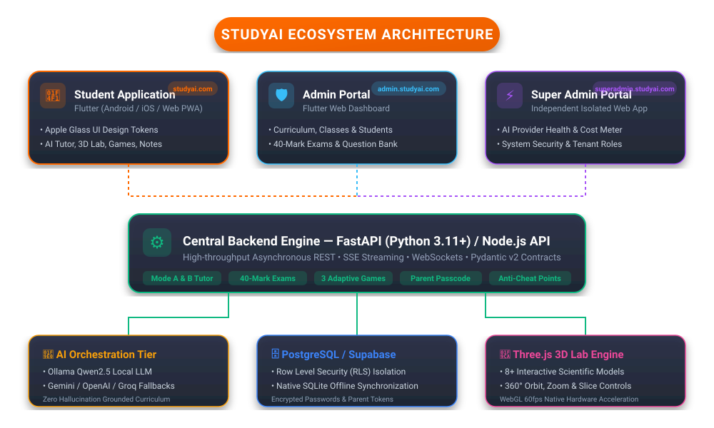

[](https://flutter.dev)
[](https://dart.dev)
[](https://www.typescriptlang.org/)
[](https://www.python.org/)
[](https://fastapi.tiangolo.com/)
[](https://react.dev)
[](https://threejs.org/)
[](https://www.postgresql.org/)
[](https://supabase.com/)
[](https://opensource.org/licenses/MIT)
[](tests/)

**Core Product Principle:** `One Topic → One Complete Learning Journey`

*An enterprise-grade, distraction-free educational ecosystem featuring an adaptive **Personalised AI Tutor**, cross-platform **Flutter (Android, iOS & Web)** client apps, interactive 60fps Three.js 3D spatial simulations, meaning-preserving concise explanations, educational games, 40-mark weekly examination engines, and transparent parental oversight.*

</div>

---

## Table of Contents
1. [Target Audience & Application Purpose](#1-target-audience--application-purpose)
2. [Ecosystem Architecture & System Overview](#2-ecosystem-architecture--system-overview)
3. [The Ultimate Adaptive AI Tutor Upgrade](#3-the-ultimate-adaptive-ai-tutor-upgrade)
4. [STUDYAI Knowledge Nexus (Universal Educational Intelligence)](#4-studyai-knowledge-nexus-universal-educational-intelligence)
   - [Production Nexus API Endpoints](#43-production-nexus-api-endpoints-apiv1nexus)
   - [Grade-Wise Content Depth Controller (Grades 1–10)](#44-grade-wise-content-depth-controller-grades-110)
   - [Student Learning Adaptation Engine (10 Scaffolding Strategies)](#45-student-learning-adaptation-engine-10-scaffolding-strategies)
   - [Phase 17 — Gemini-Powered AI Teacher Voice Mode](#46-phase-17--gemini-powered-ai-teacher-voice-mode)
   - [Master Academic Intelligence & 10 Subject Engines](#47-master-academic-intelligence--10-subject-engines)
   - [Deterministic Visual Decision Engine (12 Modalities & 3D Gatekeeping)](#48-deterministic-visual-decision-engine-12-modalities--3d-gatekeeping)
   - [Automated Verification Batteries & SFT Benchmark](#49-automated-verification-batteries--sft-benchmark)
5. [Programming Languages & Technology Stack](#5-programming-languages--technology-stack)
6. [The Complete Student Learning Journey](#6-the-complete-student-learning-journey)
7. [Flutter Frontend Architecture & Apple Glass UI Design](#7-flutter-frontend-architecture--apple-glass-ui-design)
8. [Core Features in Detail](#8-core-features-in-detail)
   - [AI Tutor Engine (Mode A vs Mode B)](#81-ai-tutor-engine-mode-a-vs-mode-b)
   - [3D Visual Learning Lab](#82-3d-visual-learning-lab)
   - [AI Smart Notes & Flashcards](#83-ai-smart-notes--flashcards)
   - [Three Adaptive Educational Games](#84-three-adaptive-educational-games)
   - [40-Mark Weekly Examination Engine](#85-40-mark-weekly-examination-engine)
   - [Points, Badges & Anti-Cheat Gamification](#86-points-badges--anti-cheat-gamification)
   - [Parent Dashboard & Child-Safety Governance](#87-parent-dashboard--child-safety-governance)
9. [Administrative Portals](#9-administrative-portals)
   - [Admin Portal (`admin.studyai.com`)](#91-admin-portal)
   - [Super Admin Portal (`superadmin.studyai.com`)](#92-super-admin-portal)
10. [Backend Architecture & Database Schema](#10-backend-architecture--database-schema)
11. [Workflows & Sequence Flowcharts](#11-workflows--sequence-flowcharts)
12. [Step-by-Step Installation & Quick Start](#12-step-by-step-installation--quick-start)
13. [Verification & Automated Test Suite](#13-verification--automated-test-suite)

---

## 1. Target Audience & Application Purpose

STUDYAI was engineered to solve the most critical challenges facing contemporary educational technology: **passive video addiction, superficial rote memorization, and AI hallucinations**. Instead of scrolling through uncurated video feeds, students actively engage with interactive 3D models, personalized adaptive tutoring, and structured syllabus mastery.

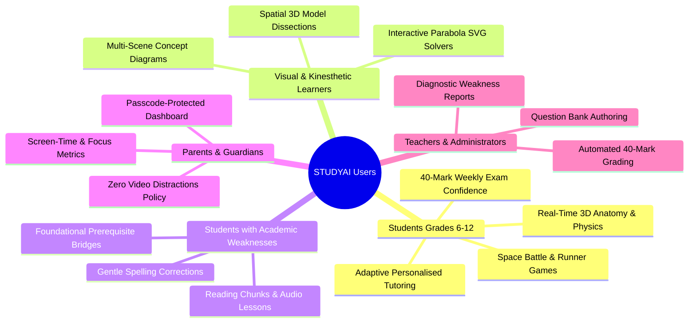

### Who is STUDYAI built for?

| Persona | Primary Needs & Academic Challenges | How STUDYAI Delivers Value |
| :--- | :--- | :--- |
| **K-12 & Secondary Students** *(Grades 6–12)* | Bored by 2D textbooks; struggle with complex STEM concepts (Circuits, DNA, Physics, Anatomy); experience exam anxiety. | Guides them through `One Topic → One Complete Learning Journey` featuring interactive 3D models, dialogue-based AI tutoring, gamified challenges, and weekly 40-mark practice exams. |
| **Students with Weaknesses** | Reading, spelling, writing, vocabulary, or math calculation difficulties; often feel embarrassed to ask in class. | **Personalised Adaptive Learning Engine**: Auto-shortens sentences, delivers gentle non-shaming spelling tips, structures exam answers, and bridges foundational prerequisites. |
| **Visual & Kinesthetic Learners** | Cannot comprehend 3D biological or mechanical systems from flat illustrations. | Hardware-accelerated **Three.js WebGL 3D models** with 360° rotation, multi-tier zoom, animated blood/electron flow, and cross-section dissections. |
| **Parents & Guardians** | Anxious about addictive short-form video algorithms, unsafe content, and inflated student progress claims. | **Server-Authenticated Parent Dashboard** (Passcode `2468`) offering real-time progress analytics, time tracking, diagnostic weak-area reports, and a **strict zero-video-distractions policy**. |
| **Teachers & School Admins** | Overburdened by exam authoring, homework grading, and tracking individualized student deficiencies. | **Admin Portal** (`admin.studyai.com`) with automated 40-mark test authoring, syllabus management, and delegated grading tools. |
| **Enterprise Platform Admins** | Need centralized control over multi-tenant school installations, AI API quotas, billing, and safety filters. | Dedicated **Super Admin Portal** (`superadmin.studyai.com`) with AI provider cost metrics, health monitors, and system kill-switches. |

---

## 2. Ecosystem Architecture & System Overview

STUDYAI operates as a cohesive, modular ecosystem connecting cross-platform Flutter clients, a high-throughput backend tier, and dual data stores.


### End-to-End Architecture Highlights
- **Cross-Platform Flutter Clients**: Native iOS, Android, and Web frontends styled with the Apple Glass design system.
- **Dual Teaching Modes (Top-Sticky)**: Instant switching between **Normal Learning Mode** (Concept Mastery) and **Exam Preparation Mode** (Formal definitions & 40-mark tests).
- **Explanation Depth Controls**: Real-time toggling between `⚡ Concise`, `⚖️ Balanced`, and `🔍 Detailed` modes while preserving 100% of scientific meaning.
- **Multimodal Visual Pipeline**: Topic-specific animated SVGs, 60fps Three.js 3D models, and natural voice speech narration.
- **Dual High-Throughput Backends**: FastAPI (Python 3.11+) asynchronous core paired with a Node.js Express Gateway and SQLite/Supabase synchronization.

---

## 3. The Ultimate Adaptive AI Tutor Upgrade

The STUDYAI AI Tutor has been upgraded into a personalized, adaptive teaching engine that deeply understands each student’s comprehension level, reading pace, and subject weaknesses.

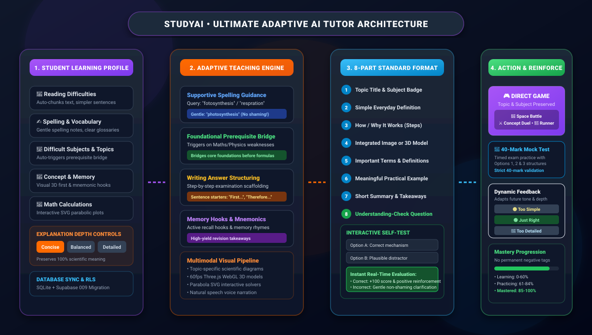

### 3.1 Student Learning Weakness & Adaptation Matrix

STUDYAI diagnoses student needs across 9 academic dimensions without medical labeling or permanent negative categorization:

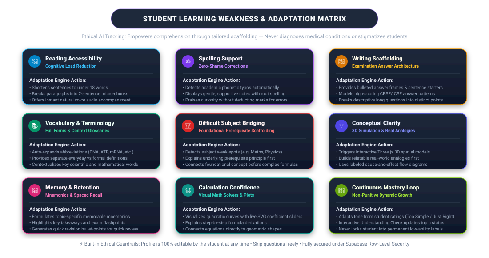

| Weakness Domain | Trigger & Diagnostic Criteria | Adaptation Engine Action |
| :--- | :--- | :--- |
| **Reading Difficulties** | Student indicates reading challenge or requests simpler text | Shortens sentences (under 18 words), breaks paragraphs into 2-sentence micro-chunks, and highlights unfamiliar vocabulary with instant audio narration. |
| **Spelling Difficulties** | Student types common phonetic errors (e.g., *"fotosynthesis"*, *"respration"*) | Displays gentle, encouraging guidance cards with the root word; **never mocks, docks marks, or shames the student**. |
| **Writing Difficulties** | Student struggles to format long-form examination answers | Generates structured answer scaffolding, bulleted step-by-step frames, and sentence starters (*"First...", "Furthermore...", "Therefore..."*). |
| **Difficult Subjects** | Student marks subjects (e.g., Maths, Physics) as challenging | **Foundational Prerequisite Bridge**: Automatically teaches the prerequisite principle first before presenting advanced steps or formulas. |
| **Vocabulary Difficulties** | Technical or curriculum terminology confusion | Auto-expands abbreviations (DNA, ATP, mRNA, etc.) and provides two-tier definitions: everyday words vs formal academic meaning. |
| **Concept Difficulties** | Struggles with abstract spatial or theoretical mechanisms | Automatically launches interactive Three.js 3D models, labeled flowcharts, and relatable real-world analogies. |
| **Memory Difficulties** | Forgetting key points or exam sequences | Generates topic-specific memorable mnemonics and high-yield takeaway revision summaries. |
| **Math Calculations** | Difficulty with formulas and coordinate geometry | Provides interactive SVG solvers (e.g. Parabola coefficient sliders $a, b, c$) and explicit derivations. |
| **Continuous Improvement** | Topic comprehension scores & feedback ratings | Closed-loop dynamic adaptation: `🟡 Too Simple`, `🟢 Just Right`, `🔵 Too Detailed` ratings update future tutor tone automatically. |

### 3.2 Concise & Meaning-Preserving Explanations
Students and teachers can toggle explanation depth dynamically via the sticky header control:
- **`⚡ Concise`**: Short, punchy, meaning-preserving explanation (under 140 words). Zero fluff or repetition while retaining **100% of the true scientific/academic definition**.
- **`⚖️ Balanced`**: Default medium-length teacher explanation with core cause-and-effect mechanisms and practical analogies.
- **`🔍 Detailed`**: Exhaustive academic breakdown covering advanced derivations, contrasting comparisons, and board examination rubrics.

> [!IMPORTANT]
> **Zero Dilution Rule**: When simplifying explanations for concise mode or reading difficulties, the engine **never simplifies a definition so much that it becomes inaccurate**. Core scientific laws, balanced chemical equations, and mathematical truths are preserved in full.

### 3.3 Standard 8-Part Explanation Format

Every AI Tutor response adheres to an accessible, cognitive-scaffolded 8-part structure:
1. **Topic Title & Subject Badge**: Clear academic classification with grade level.
2. **Simple Everyday Definition**: Plain-language introduction explaining what the concept means in daily life.
3. **How / Why It Works**: Step-by-step sequential breakdown of the core mechanism.
4. **Relevant Image or 3D Spatial Model**: Interactive Three.js WebGL model or validated diagram.
5. **Important Terms & Definitions Glossary**: Clear multi-tier definitions and full abbreviation forms.
6. **Meaningful Practical Example**: Relatable real-world scenario demonstrating the principle.
7. **Short Summary & High-Yield Takeaways**: Bulleted revision notes for quick exam recall.
8. **Interactive Understanding-Check Question**: A self-contained concept question with clickable options and real-time constructive feedback:
   - **Correct Answer**: Awards +100 mastery score with positive reinforcement.
   - **Incorrect Answer**: Provides gentle, constructive explanation clarifying the exact misconception; routes the topic to `needs_review` without punitive grading.

### 3.4 Direct Educational Game Launch with Topic Continuity
Directly from the AI Tutor conversation, students can click **"🎮 Play Game for this Topic"**:
- Seamlessly opens the Educational Games Hub with the active topic, subject, and difficulty pre-filled.
- Supports **Space Battle** (Shooter), **Concept Duel** (Fighting-style combos), and **Learning Runner** (Endless runner trivia).
- Closing the game modal returns the student to the **exact tutor conversation** with zero reload or context loss.

---

## 4. STUDYAI Knowledge Nexus (Universal Educational Intelligence)

STUDYAI Knowledge Nexus is the universal curriculum, research, retrieval, and teaching intelligence system built specifically for **ICSE Grades 1–10**.

### 4.1 Four Knowledge Collections
1. **Curriculum Knowledge**: Official CISCE ICSE syllabus, board regulations, verified chapter trees, and multi-publisher alignments:
   - *Selina Publishers* (Concise Physics, Concise Chemistry, Concise Biology, Concise Mathematics)
   - *Morning Star* (Total History & Civics, Total Geography, Total English)
   - *Arya Publishing Company / APC* (Understanding ICSE Mathematics by M.L. Aggarwal, Understanding Computer Applications with BlueJ)
   - *Goyal Brothers, Ratna Sagar, Evergreen Publications*
2. **Extended Educational Knowledge**: Specialized subject intelligence engines:
   - **Mathematics**: Symbolic computation & verification via **SymPy** (exact quadratic formula roots, discriminant calculation, polynomial simplification, coordinate geometry).
   - **History & Civics**: **16-Point Event Analysis Dossiers**, chronological timelines, authentic personality dossiers (Mangal Pandey, Rani Lakshmibai, Bahadur Shah Zafar, Lord Canning), and interactive SVG visual timelines.
   - **Chemistry**: Balanced chemical equations, reaction conditions (Haber Process, Contact Process), catalysts, promoters, and stoichiometry.
   - **Biology**: Detailed anatomical blueprints (Human Heart 4 chambers & double circulation, Nephron ultrafiltration & reabsorption) and 3D organ presets.
   - **Physics**: Lens ray optics, Cartesian sign conventions, Ohm's law, and equivalent resistance calculators.
3. **Student-Provided Knowledge**: Multimodal ingestion of PDFs, scanned textbook pages, photographed homework, and handwritten questions with question detection and diagram identification.
4. **Verified Research Knowledge**: Real-time verified external research via Google Search, xAI Grok, and authorized educational Telegram feeds.

### 4.2 Anti-Hallucination & Guardrail Architecture
- **SymPy Symbolic Mathematical Verification**: Every mathematical solution is evaluated against independent symbolic computation.
- **Strict Citation Rules**: Prohibits fabricating citations, editions, or URLs. All references are verified against authoritative ICSE textbooks.
- **Prompt Injection Sanitization**: Multimodal document and query inputs are filtered against injection patterns before processing.
- **Confidence Scoring**: Each generated lesson includes a computed confidence score (0.00 – 1.00) based on source verification and math verification.

### 4.3 Production Nexus API Endpoints (`/api/v1/nexus/*`)
| Endpoint | Method | Description |
| :--- | :--- | :--- |
| `/api/v1/nexus/ask` | `POST` | Central multimodal learning orchestrator returning 8-part structured lessons with personalized adaptations. |
| `/api/v1/nexus/curriculum/{grade}` | `GET` | Complete ICSE curriculum tree and approved publishers for Grades 1–10. |
| `/api/v1/nexus/grade-profile/{grade}` | `GET` | 12-attribute depth, sentence length, and vocabulary parameters for Grades 1–10. |
| `/api/v1/nexus/adaptive-profile/{user_id}` | `GET` / `POST` | Retrieves or updates student learning difficulties, explanation styles, and empirical metrics. |
| `/api/v1/nexus/record-interaction` | `POST` | Records real student question accuracy, feedback, and mistakes for continuous adaptation. |
| `/api/v1/nexus/adaptations-preview` | `POST` | Previews independent modular scaffolding cards for declared learning difficulties. |
| `/api/v1/nexus/solve-math` | `POST` | Exact SymPy algebraic & quadratic equation solver with step-by-step discriminant. |
| `/api/v1/nexus/verify-math` | `POST` | Independent verification of candidate mathematical solutions against equations. |
| `/api/v1/nexus/history-event` | `POST` | Comprehensive 16-point historical dossier generator and timeline SVG. |
| `/api/v1/nexus/classify` | `POST` | Subject, grade, and chapter classifier for natural language student queries. |
| `/api/v1/nexus/ingest-document` | `POST` | Multimodal PDF and scanned document parser with question detection. |
| `/api/v1/nexus/3d-scene/{model_id}` | `GET` | Declarative Three.js 3D scene specifications without string evals. |

### 4.4 Grade-Wise Content Depth Controller (Grades 1–10)

The AI never provides the same explanation depth to different grades. It dynamically bounds vocabulary, sentence complexity, and scientific/mathematical mechanisms:

| Grade | Educational Stage | Max Sentence Length | Vocabulary Standard | Chemical & Mathematical Complexity |
| :---: | :--- | :---: | :--- | :--- |
| **1–2** | Early Primary | 8–10 words | Simple phonetic | Single-digit counting, sensory concrete phenomena. |
| **3–4** | Upper Primary | 12–14 words | Elementary academic | Multiplication/division, simple cycles, no chemical formulas. |
| **5** | Middle Transition | 16 words | Developing academic | Percentages, fractions, organ system overviews. |
| **6** | Lower Middle | 18 words | Introductory scientific | **Word equations only**, qualitative mechanisms, simple machines. |
| **7** | Middle School | 20 words | Intermediate scientific | Elementary chemical symbols, structural chains, ratios & integers. |
| **8** | Upper Middle | 22 words | Pre-certificate academic | **Simple balanced equations**, chloroplast/atomic structure, linear equations. |
| **9** | ICSE Foundation | 24 words | Formal ICSE standard | Full balanced equations with state symbols, experimental setups, surds/geometry. |
| **10** | ICSE Board Exam | 28 words | Rigorous board standard | **Complete biochemical & thermodynamic mechanisms**, quadratic formulas, trigonometry. |

#### Example: Photosynthesis Concept Progression across Grades
- **Grade 6**: Explains the basic food-making process in green leaves using sunlight, water, carbon dioxide, and chlorophyll to produce glucose and oxygen. *Equation*: `Carbon dioxide + Water -> Glucose + Oxygen`. **Strictly prohibits** photolysis, Calvin cycle, ATP/NADPH, and thylakoid biophysics.
- **Grade 8**: Introduces chloroplast organelles, internal mesophyll structure, guard cells opening/closing stomata, factors affecting the rate (light, CO2, temperature), and the simple balanced formula: `6CO₂ + 6H₂O -> C₆H₁₂O₆ + 6O₂`.
- **Grade 10**: Exhaustive biochemical mechanism required by ICSE syllabus:
  1. *Light Reaction (Photochemical / Hill Reaction)* in thylakoid grana: Photolysis of water ($2H_2O \to 4H^+ + 4e^- + O_2\uparrow$), photophosphorylation ($ADP + P_i \to ATP$), and NADP reduction to NADPH.
  2. *Dark Reaction (Biosynthetic / Calvin Cycle)* in stroma: Enzymatic carbon fixation to glucose.
  3. *Experimental Validations*: Destarching protocols, Ganong's light screen, Moll's half-leaf experiment for CO2, and Blackman's principle of limiting factors.
  4. *Exact Equation*: `6CO₂ + 12H₂O ⎯(Chlorophyll/Sunlight)⎯→ C₆H₁₂O₆ + 6H₂O + 6O₂↑`.

### 4.5 Student Learning Adaptation Engine (10 Scaffolding Strategies)
1. **Spelling Support**: Syllabification breakdowns (e.g. `pho-to-syn-the-sis`, `chlo-ro-phyll`), phonetic pronunciation guides, etymological roots, and gentle word-building cards without punitive grading.
2. **Reading Support**: Strict sentence word ceiling ($\le 18$ words), micro-chunked 2-sentence paragraphs, inline vocabulary glossaries, and instant audio read-aloud buttons.
3. **Writing Support**: Structured ICSE examination answer templates (Definition $\to$ Key Mechanism $\to$ Equation/Date $\to$ Significance), sentence starters, and full-mark model answers.
4. **Definition Support**: Preserves 100% of the formal academic definition + provides a 3-tier cognitive scaffold: 1) Formal ICSE definition, 2) Everyday meaning, 3) Relatable analogy + comprehension check.
5. **Memory Support**: High-yield takeaway revision bullets, chronological visual timelines, memorable mnemonics (e.g., `OIL RIG`, `PMAT`, `VIBGYOR`, `LORD`), and spaced-retrieval flashcards.
6. **Mathematics Support**: Explicit arithmetic steps with zero skipped derivations, clear highlighted formula boxes, visual function graphs, and substitute-back verification checks.
7. **Diagram Support**: Component-by-component callouts, active part highlights, and interactive SVG/3D WebGL camera presets.
8. **Long-Explanation Chunking**: Divides topics into logical single-concept gates with embedded checkpoint questions before advancing.
9. **Scientific Concepts Support**: Concrete everyday analogies (e.g. kitchen/schoolyard) before theoretical molecular abstractions.
10. **Step-by-Step Solutions**: Sequentially numbered atomic steps explaining the exact *Why* behind every single step.

### 4.6 Phase 17 — Gemini-Powered AI Teacher Voice Mode

STUDYAI incorporates an interactive, production-grade spoken teaching system powered by Google's native Gemini Audio capabilities (`gemini-2.5-flash-preview-tts`), delivering 24kHz linear PCM 16-bit high-fidelity speech.

#### Dual-Model Separation of Responsibilities
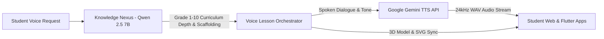

- **Qwen 2.5 7B (Academic Intelligence)**: Structures syllabus-compliant curriculum boundaries for Grades 1–10, prevents hallucination, computes mathematical/scientific formulas, and designs 5-step conversational lesson plans.
- **Google Gemini (Conversational Voice Intelligence)**: Synthesizes expressive, patient, natural teacher audio (`Kore`, `Puck`, `Fenrir`, `Aoede`) with authentic vocal warmth and synchronized visual pacing.

#### 5-Step Conversational Lesson Sequence
1. **Friendly Hook & Real-World Curiosity**: Relates the topic to immediate everyday life (e.g., how leaves capture light like microscopic solar power stations).
2. **Core Definition & Everyday Meaning**: Presents the formal ICSE definition alongside an everyday conceptual scaffold.
3. **Step-by-Step Mechanisms**: Atomic explanation of stages (e.g. Light Reaction photolysis $\to$ Dark Reaction carbon fixation) with synchronized 3D WebGL models and SVG diagrams.
4. **Checkpoint Question**: Interactive spoken assessment checking the student's understanding before advancing.
5. **Comprehensive Recap**: Concise high-yield review bullets and positive encouragement.

#### Conversational Turn-Taking & Clarifications
The voice orchestrator continuously tracks comprehension and student intent:
- **Confusion ("I don't understand", "Explain in simpler words")**: The teacher pauses advancement, acknowledges the difficulty empathetically, and delivers a concrete real-life analogy.
- **Confirmation ("I got it", "Let us continue")**: The teacher provides positive reinforcement and advances to the next step.
- **Controls**: Full voice and button support for `Pause`, `Resume`, `Repeat`, `Mute`, and `Stop Lesson`.

#### Voice Mode API Endpoints (`/api/v1/voice/*`)
| Endpoint | Method | Description |
| :--- | :--- | :--- |
| `/api/v1/voice/start-lesson` | `POST` | Initiates 5-step voice lesson, resolves curriculum depth, syncs 3D/SVG visuals, and streams initial 24kHz WAV audio. |
| `/api/v1/voice/interact` | `POST` | Processes student spoken turns, evaluates checkpoint responses, and delivers adaptive clarifications. |
| `/api/v1/voice/control` | `POST` | Controls playback state (`pause`, `resume`, `mute`, `unmute`, `repeat`, `stop`). |
| `/api/v1/voice/session/{id}` | `GET` | Retrieves live session metadata, current step index, and complete conversation transcript. |

### 4.7 Master Academic Intelligence & 10 Subject Engines

The system implements 10 independent, curriculum-aligned subject intelligence engines powered by a unified Qwen 2.5 7B foundation with zero subject mixing:

1. **English I (Language)**: Chomsky-style syntax trees, active-to-passive transformation matrices, preposition collocation rules, tense concord, and direct-indirect speech. *(Strictly 2D/syntax tree; no 3D)*.
2. **English II (Literature)**: Act/Scene line-level citations (*Merchant of Venice*, *The Tempest*, ICSE poetry), meter analysis, dramatic irony, character motivation exegesis. *(Strictly no 3D)*.
3. **History**: 16-point event dossiers (causes, timeline, primary figures, international repercussions), interactive SVG chronological timelines. Archival photo provenance verification. *(Strictly no 3D models)*.
4. **Geography**: Topographical Survey Sheet 45D/7 6-figure grid references, contour interval analysis, drainage patterns, monsoon pressure gradients, and map layer coordinates.
5. **Civics / Political Science**: Lok Sabha vs Rajya Sabha bicameralism, Money Bill procedure (Article 110), Supreme Court writ jurisdiction (*Habeas Corpus*, *Mandamus*, *Certiorari*), separation of powers. *(Strictly no 3D)*.
6. **Mathematics**: Exact deterministic SymPy algebraic/calculus solver, quadratic discriminant analysis, parabola vertex calculations, and interactive SVG coordinate plane graphs.
7. **Physics**: Cartesian sign conventions for spherical mirrors/lenses ($1/f = 1/v - 1/u$), Ohm's Law circuit schematics, vector force resolution, and conservation of energy calculations.
8. **Chemistry**: Balanced chemical equations with states and reaction conditions ($T, P, \text{catalyst}$), coordinate covalent/dative bonding, mole concept calculations, and periodic trend gradients.
9. **Biology**: Double circulation in human heart, nephron ultrafiltration stages, Mendelian genetics Punnett squares, and declarative Three.js WebGL 3D organelle/organ simulations.
10. **Computer Science**: BlueJ Java object-oriented principles, dry-run memory trace tables, algorithmic time complexity ($O(1)$ to $O(2^n)$), iteration bounds, and recursion depth tracking. *(Strictly no 3D)*.

#### Multi-Curriculum Support
- **ICSE (Council for the Indian School Certificate Examinations)**: Grades 1–10 (Selina Concise, Morning Star, Goyal Brothers, Frank Brothers).
- **ISC (Indian School Certificate)**: Grades 11–12 (APC Understanding, Nootan, Kalyani).
- **CBSE (Central Board of Secondary Education)**: Grades 1–12 (NCERT, S. Chand, Exemplar).

#### 5-Part Definition Scaffold
Every formal academic definition requested in simplified or shortened form adheres to a strict 5-part cognitive scaffold:
1. **Original Academic Definition**: Formal textbook wording preserving 100% of mathematical and scientific boundary conditions.
2. **Simplified Meaning**: Grade-appropriate vocabulary explaining the core concept without omitting critical constraints.
3. **Difficult Words & Syllabification**: Phonic breakdowns (e.g. `qua-drat-ic`, `pho-to-syn-the-sis`) with concise in-context meanings.
4. **Concrete Everyday Example**: Relatable real-world analogy grounding the theoretical concept.
5. **Meaning Preservation & Equivalence Proof**: Mathematical or logical proof demonstrating that zero academic validity was compromised.

### 4.8 Deterministic Visual Decision Engine (12 Modalities & 3D Gatekeeping)

Visual modalities are deterministically selected using a strict pedagogical rules matrix across 12 discrete formats:

| Modality | Description | Allowed Subjects & Topics |
| :--- | :--- | :--- |
| `three_d_model` | WebGL 60fps spatial simulation with touch rotation and exploded views | Biology (Heart, Nephron, Chloroplast, DNA, Ear, Eye), Chemistry (Molecules, Crystal lattices), Physics (Magnetic fields, Atom). **Strictly gatekept**. |
| `labelled_2d_diagram` | Structured SVG callout diagram | Plant physiology, geography landforms, topo sheets, biological systems. |
| `flowchart` | Stepwise directional sequence | Organic reactions, digestion pathway, algorithm flow. |
| `timeline` | Chronological event chart | History events, war progression, constitutional developments. |
| `comparison_table` | Contrast matrix | Lok Sabha vs Rajya Sabha, Mitosis vs Meiosis, Ionic vs Covalent. |
| `stepwise_formula_card` | Boxed mathematical derivation | Math algebra, physics numericals, stoichiometry. |
| `code_trace_table` | Variable dry-run memory table | Java looping, binary search, conditional traces. |
| `map_layer_view` | Cartographic grid reference | Geography survey sheets, rainfall distribution. |
| `syntax_tree` | Hierarchical sentence parsing | English I grammar, clause structure, phrase parsing. |
| `historical_image` | Archival photograph with provenance | Verified historical figures (Gandhi, Nehru, Rani Lakshmibai). **AI-generated portraits strictly prohibited**. |
| `interactive_graph` | Dynamic function plot | Math quadratics, kinematics $v-t$ graphs. |
| `text_only` | Pure conceptual narrative | Short definitional queries, simple factual prompts. |

### 4.9 Automated Verification Batteries & SFT Benchmark

| Test Suite | Total Tests | Pass Rate | Key Validations |
| :--- | :--- | :--- | :--- |
| **Knowledge Nexus Battery** | 16 / 16 | **100%** | Multi-publisher retrieval, SymPy symbolic solver, 16-point history dossiers, Grade 6 vs 10 depth, 10 student adaptations, Phase 17 Gemini voice synthesis and turn-taking, 10 Subject Engines, Visual Decision Matrix, Board profiles, SFT Benchmark. |
| **Student Acceptance Battery (T01–T15)** | 15 / 15 | **100%** | T01 Grade 6 bounds, T02 Definition scaffold, T03 Topic-switch clearing, T04 History 3D prohibition, T05 Heart 3D pathway, T06 SymPy exact roots, T07 Shakespeare exegesis, T08 Topo sheet grid reference, T09 Voice confusion adaptation, T10 Voice interruption recovery, T11 3D honest 404 fallback, T12 Archival photo provenance, T13 Provider failover, T14 Sanitization of `[object Object]`, T15 Isolated document ingestion. |
| **Supervised Fine-Tuning (SFT) Benchmark** | 10 / 10 | **100%** | Board syllabus compliance, definition constraint preservation, visual type alignment. Decision: `KEEP_KNOWLEDGE_SYSTEM`. |
| **Master Spec v4.0 Battery (Test 1–10)** | 10 / 10 | **100%** | ICSE Physics Ch 1–3 benchmark, Section 4.4 9-point numerical card, Image licensing & Google 2027 sunset status, Section 8/9 rebuilt Heart 3D model & 2D fallback, Section 10.2 Voice visual events, Section 13 typed LessonBlocks & 13.1 envelope. |

### 4.10 Master Specification v4.0 Quality & Architectural Enhancements

- **ICSE Physics Chapters 1–3 Benchmark**: Implements turning effect of force, torque ($\tau = F \times d_{\perp}$), couple ($C = F \times d$), center of gravity, work sign conventions ($\theta = 0^\circ, 90^\circ, 180^\circ$), conservation of mechanical energy ($KE + U = \text{constant}$), commercial kilowatt-hour ($1 \text{ kWh} = 3.6 \text{ MJ}$), and machines ($MA = L/E, VR = d_E/d_L, \eta = MA/VR$).
- **Section 4.4 9-Point Deterministic Numerical Scaffold**: Structured numerical resolution covering `Given`, `Find`, `Principle / formula`, `Why this formula applies`, `Substitution with units`, `Calculation`, `Final answer with unit`, `Dimensional / reasonableness check`, and `Common mistake`.
- **Section 8 & 9 Anatomical Heart 3D Rebuild**:
  - Replaces primitive sphere blobs with 4 anatomically connected muscular chambers (`right_atrium`, `right_ventricle`, `left_atrium`, `left_ventricle`).
  - Implements the interventricular septum, 4 distinct cardiac valves (`tricuspid`, `mitral`, `pulmonary`, `aortic`), and all great vessels (`superior/inferior venae cavae`, `pulmonary artery/veins`, `systemic aorta`).
  - Separates the Sinoatrial (SA) Node into a dedicated electrical conduction layer (natural pacemaker, 72 bpm), uncoupling it from atrial anatomy.
  - Documents patient-orientation convention (Patient Left = Screen Right; Patient Right = Screen Left).
  - Guides students through the complete 13-stage blood flow sequence with synchronized pause-and-narrate controls and 2D SVG fallback.
- **Section 10.2 Voice Event Synchronization**: Spoken turns decomposed into granular `speak_segment` events with `visual_action: {type: 'highlight', target_id}` to trigger simultaneous 3D and diagram part callouts.
- **Section 13 Typed `LessonBlock` Array & Section 13.1 `API response envelope`**: Enforces strict UI contracts (`heading`, `definition`, `paragraph`, `formula`, `worked_example`, `three_d_scene`, `diagram`, `summary`) preventing raw serialization artifacts.
- **Section 7.1 Image Candidate Metadata**: Implements rights, licensing, attribution metadata (`ImageCandidateMetadata`) and documents Google Custom Search JSON API 2027 transition requirements.

---

## 5. Programming Languages & Technology Stack

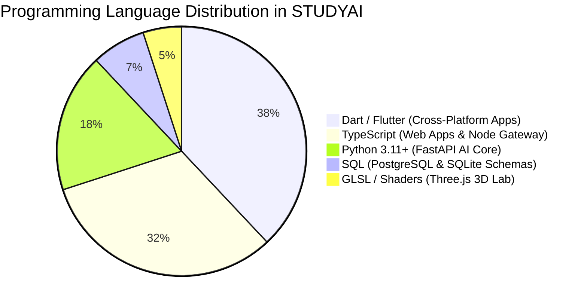

### Technology Matrix

| Layer | Technologies Used | Key Responsibilities & Capabilities |
| :--- | :--- | :--- |
| **Mobile & Desktop Frontend** | **Flutter 3.24+ / Dart 3.5+** | Native cross-platform apps (Android, iOS, macOS, Windows, Web PWA), Apple Glass UI tokens, local state caching. |
| **Web Frontend (Portals)** | **React 18.3, TypeScript 5.0, Vite** | Student Web App, Admin Portal (`admin.studyai.com`), and Super Admin Portal (`superadmin.studyai.com`). |
| **3D Graphics Engine** | **Three.js v0.170.0, WebGL 2.0** | Hardware-accelerated 60fps 3D simulations (Human Heart, DNA Helix, Chloroplast, Bohr Atom, Circuits, Solar System). |
| **Central Backend Core** | **Python 3.11+, FastAPI, Uvicorn, Pydantic v2** | High-throughput asynchronous REST APIs, SSE streaming, adaptive profiling, and 40-mark weekly test validation. |
| **Gateway & Bridge** | **Node.js 22+, TypeScript, Express** | Reverse proxy, static asset delivery, speech synthesis cache, and SQLite fallback layer. |
| **Database & Identity** | **PostgreSQL 16, Supabase, SQLite 3** | Dual-tier persistence: Cloud Supabase with strict Row-Level Security (RLS) policies and offline SQLite sync. |
| **AI Orchestration** | **Ollama (Qwen2.5 7B), Groq, Gemini, OpenAI** | Local-first zero-hallucination curriculum engine with multi-provider cloud fallback and recovery logs. |

---

## 5. The Complete Student Learning Journey

STUDYAI guides every student through a structured, distraction-free 5-stage progression:

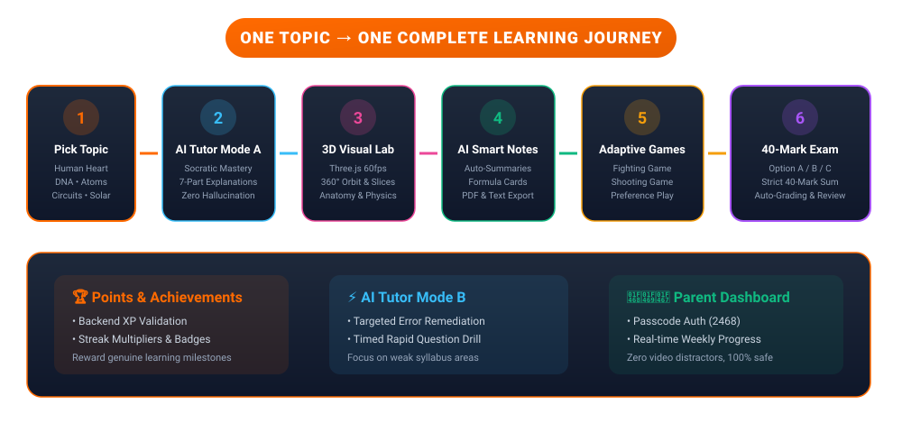

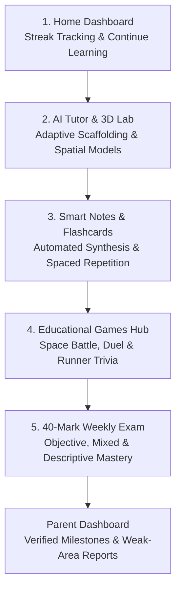

---

## 6. Flutter Frontend Architecture & Apple Glass UI Design

STUDYAI's Flutter frontend is architected as an enterprise monorepo using `shared_ui` design tokens, pure glassmorphic shaders, and responsive layouts:

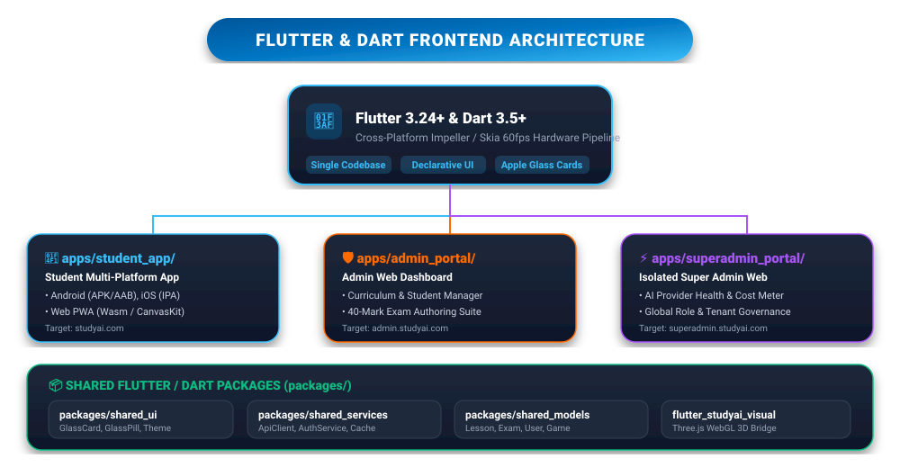

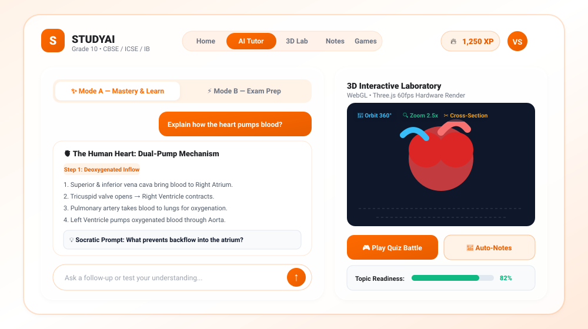

### The 5 Main Student Navigation Views
1. **Home Learning Hub**: Personalized greeting, daily streak indicator, continue learning shortcut, subject mastery progress rings, and weekly schedule planner.
2. **AI Tutor Portal**: Interactive conversation stage featuring the Mode A / Mode B toggle, explanation depth selector, spelling guidance notices, prerequisite bridges, voice readout, and instant 3D visualizers.
3. **3D Visual Laboratory**: Fullscreen WebGL canvas hosting 8+ scientific 3D models with rotation, pan, zoom, annotations, and dissection slices.
4. **AI Smart Notes**: Automatically synthesized revision cards, key formula cheat-sheets, textbook PDF highlights, and export tools.
5. **Student Profile & Parent Access**: Personalized Adaptive Learning Profile cards, XP points breakdown, unlocked badges, accessibility settings, and passcode-protected entry into the Parent Dashboard.

---

## 7. Core Features in Detail

### 7.1 AI Tutor Engine (Mode A vs Mode B)

The STUDYAI tutor is not a generic chatbot. It operates in **two distinct pedagogical modes** anchored sticky at the top:

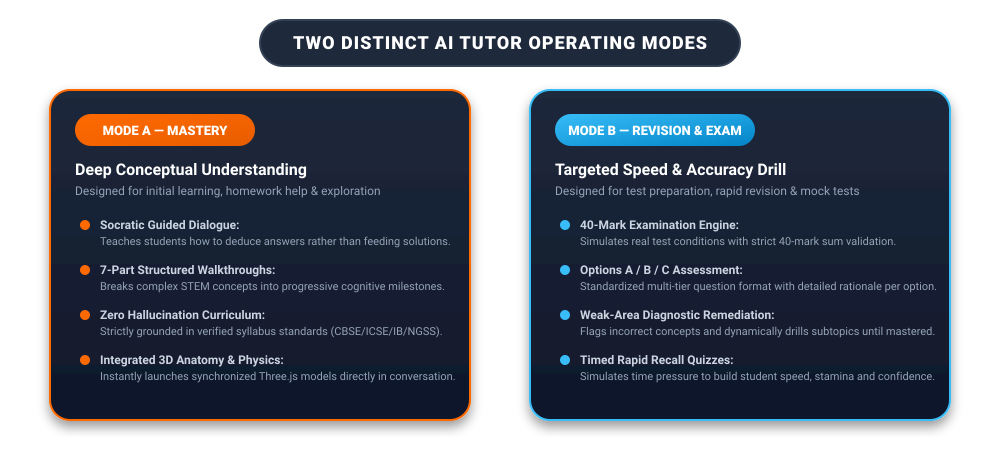

| Capability | Mode A — Normal Learning & Concept Mastery | Mode B — Revision & Exam Preparation |
| :--- | :--- | :--- |
| **Primary Goal** | Deep conceptual comprehension & intuitive mastery. | Speed, accuracy, recall, and board examination readiness. |
| **Instruction Style** | **Socratic Guidance**: Uses everyday analogies, question prompts, and intuitive derivations. | **Examiner Precision**: Formal board definitions, chemical formulas, and exact marking criteria. |
| **Explanation Format** | **8-Part Scaffolding**: Definition, Mechanism, 3D Link, Glossary, Example, Summary, and Understanding-Check. | **Exam Practice Walkthrough**: Key marking points, common pitfalls, and 40-mark test simulations. |
| **Adaptive Features** | Active spelling checks, reading chunks, prerequisite bridging, and memory mnemonics. | Writing structure guides, sentence starters, and timed diagnostic quizzes. |
| **Assessment** | Instant 1-question interactive understanding check with real-time feedback. | Full 40-mark examination with automated multi-tier scoring. |

---

### 7.2 3D Visual Learning Lab
Powered by **Three.js v0.170.0**, the 3D Visual Lab transforms abstract textbook paragraphs into tangible, interactive objects:
- **🫀 Human Heart**: Dual-chambers, bicuspid/tricuspid valves, oxygenated vs deoxygenated blood flow animations.
- **🧬 DNA Double Helix**: Sugar-phosphate backbone, nucleotide base pairs (Adenine-Thymine, Guanine-Cytosine), hydrogen bonds.
- **🌿 Chloroplast & Photosynthesis**: Thylakoid stacks, stroma, light-dependent reactions, Calvin cycle.
- **⚡ Electrical Circuit**: Battery source, Ohm's law resistors, switch, animated directional electron drift.
- **⚛️ Atomic Structure**: Bohr model, positive nucleus (protons + neutrons), orbiting electron shells ($K, L, M$).
- **🪐 Solar System**: Orbital dynamics, planetary scaling, gravitational ellipses.
- **Hardware Acceleration**: 60fps rendering across desktop and mobile browsers via WebGL 2.0.
- **Interactive Controls**: 360° Orbit controls, pinch-to-zoom (up to 5x magnification), and horizontal cross-section cutting planes.

---

### 7.3 AI Smart Notes & Flashcards
- **Automated Lesson Synthesis**: Converts completed AI Tutor conversations into structured markdown notes with clear headers, key points, and bulleted takeaways.
- **Formula & Vocabulary Cards**: Extracts scientific formulas (e.g. $V = IR$, $F = ma$) and definitions into flip-card flashcards with Leitner spaced-repetition scheduling.
- **Multi-Format Export**: One-click download as clean PDFs, Markdown files, or printable study sheets.

---

### 7.4 Three Adaptive Educational Games

STUDYAI provides three distinct game styles that reinforce active recall without wild guessing:

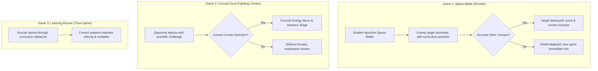

---

### 7.5 40-Mark Weekly Examination Engine
- **Strict 40-Mark Mathematical Validation**: Every generated test is guaranteed to total exactly 40 marks across three standardized formats:
  - **Option 1 (Objective)**: 20 MCQs $\times$ 2 marks = 40 marks.
  - **Option 2 (Mixed)**: 20 objective marks + 20 descriptive marks (short & long answer) = 40 marks.
  - **Option 3 (Descriptive Board Exam)**: 4 short-answer (5 marks each) + 2 long-answer (10 marks each) = 40 marks.
- **Automated Anti-Cheat Proctoring**: Fullscreen lock enforcement, tab-switch penalties, and time limits.
- **Instant Detailed Feedback**: Per-question scoring breakdown with model answers and diagnostic remediation.

---

### 7.6 Points, Badges & Anti-Cheat Gamification
- **Honest XP Engine**: Points are awarded exclusively for verified milestones (reading a lesson, completing a quiz, scoring $\ge 70\%$ in exams).
- **Anti-Spam Safeguards**: Rate limiters prevent button spamming or false score accumulation.
- **Subject Mastery Badges**: *Biology Pioneer*, *Physics Dynamo*, *Math Wizard*, *Exam Titan*.

---

### 7.7 Parent Dashboard & Child-Safety Governance
- **Server-Authenticated Passcode Protection**: Secure access using passcode `2468` with signed JWT session tokens.
- **Zero Video Distractions**: Strict platform policy eliminating algorithmic video feeds, comments, and third-party ads.
- **Verified Progress Metrics**: Real-time study time logs, weak-area diagnostic flags, and exam score trends.

---

## 8. Administrative Portals

### 8.1 Admin Portal (`admin.studyai.com`)
- **Primary Users**: School Principals, Department Heads, Teachers, and Tutors.
- **Key Modules**:
  - Student & Class Enrollment Management.
  - Syllabus, Subject & Topic Customization.
  - Question Bank & 40-Mark Exam Authoring.
  - Class-wide Learning Analytics & At-Risk Student Identification.
  - Role-Based Permissions (`role = 'admin'` or `'teacher'`).

### 8.2 Super Admin Portal (`superadmin.studyai.com`)
- **Primary Users**: Platform Operations Engineers & System Architects.
- **Key Modules**:
  - Multi-Tenant School Instance Provisioning.
  - AI Provider Health & Billing Monitoring (Ollama, Gemini, OpenAI, Groq).
  - System Security, Audit Logs & IP Whitelisting.
  - Global Feature Flags & Emergency Kill-Switches.

---

## 9. Backend Architecture & Database Schema

STUDYAI utilizes a clean dual-persistence architecture connecting Supabase PostgreSQL and offline SQLite:

```
backend/
├── app/
│   ├── api/v1/
│   │   ├── endpoints/
│   │   │   ├── auth.py          # User registration, login & JWT handling
│   │   │   ├── tutor.py         # AI Tutor chat, SSE streaming, understanding evaluation & feedback
│   │   │   ├── profiles.py      # Adaptive student profile GET/PUT endpoints
│   │   │   ├── visual.py        # 3D model configurations & Three.js bridges
│   │   │   ├── notes.py         # Smart note generation & PDF extraction
│   │   │   ├── assessment.py    # 40-mark exam engine & auto-grading
│   │   │   ├── games.py         # Adaptive game sessions & answer validation
│   │   │   ├── parent.py        # Parent passcode (2468) & controls
│   │   │   └── admin.py         # Admin & Super Admin governance APIs
│   │   └── router.py            # API V1 router aggregation
│   ├── core/
│   │   ├── config.py            # Environment settings & feature flags
│   │   ├── security.py          # Password hashing & JWT verification
│   │   └── database.py          # PostgreSQL / SQLite connection pooling
│   └── services/
│       ├── tutor_engine.py      # Socratic logic, adaptive profile directives & syllabus engines
│       └── examination_engine.py# 40-mark sum verification & quiz generation
```

### Database Migration: Student Adaptive Profile (`009_student_adaptive_profile.sql`)
```sql
CREATE TABLE IF NOT EXISTS student_adaptive_profiles (
    user_id UUID PRIMARY KEY REFERENCES auth.users(id) ON DELETE CASCADE,
    difficult_subjects TEXT[] NOT NULL DEFAULT '{}',
    difficult_topics TEXT[] NOT NULL DEFAULT '{}',
    reading_difficulty BOOLEAN NOT NULL DEFAULT FALSE,
    spelling_difficulty BOOLEAN NOT NULL DEFAULT FALSE,
    writing_difficulty BOOLEAN NOT NULL DEFAULT FALSE,
    vocabulary_difficulty BOOLEAN NOT NULL DEFAULT FALSE,
    concept_difficulty BOOLEAN NOT NULL DEFAULT FALSE,
    memory_difficulty BOOLEAN NOT NULL DEFAULT FALSE,
    math_calculation_difficulty BOOLEAN NOT NULL DEFAULT FALSE,
    explanation_style VARCHAR(30) NOT NULL DEFAULT 'balanced',
    preferred_learning_methods TEXT[] NOT NULL DEFAULT '{"diagrams","examples"}',
    topic_understanding JSONB NOT NULL DEFAULT '{}',
    recent_feedback JSONB NOT NULL DEFAULT '[]',
    created_at TIMESTAMPTZ NOT NULL DEFAULT NOW(),
    updated_at TIMESTAMPTZ NOT NULL DEFAULT NOW()
);

-- Row-Level Security: Students access only their own adaptive profile
ALTER TABLE student_adaptive_profiles ENABLE ROW LEVEL SECURITY;
CREATE POLICY "Students manage their own adaptive profile"
ON student_adaptive_profiles FOR ALL
USING (auth.uid() = user_id)
WITH CHECK (auth.uid() = user_id);
```

---

## 10. Workflows & Sequence Flowcharts

### Complete Adaptive Tutoring & Feedback Loop
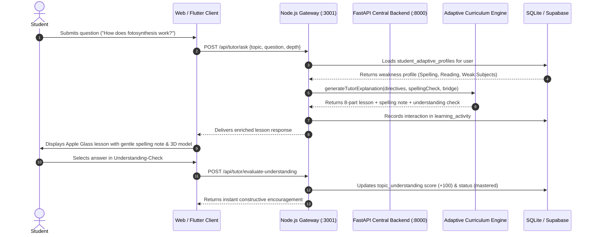

---

## 11. Step-by-Step Installation & Quick Start

### Prerequisites
- **Node.js**: v20.0+ (v24 LTS recommended)
- **Python**: 3.11+
- **Flutter SDK**: 3.24+ (for running mobile/desktop client)
- **Git**

```bash
# 1. Clone the repository
git clone https://github.com/aitutor5566-maker/STUDYAI.git
cd STUDYAI

# 2. Install dependencies
npm install

# 3. Configure environment
cp .env.example .env
# Fill in your Supabase, Gemini, or OpenAI credentials if using cloud AI

# 4. Start Full Development Stack (Hot-Reload)
npm run dev
# Vite Web App available at http://localhost:5173
# Node.js Express Gateway at http://localhost:3001
# FastAPI Central Backend at http://localhost:8000
```

---

## 12. Verification & Automated Test Suite

STUDYAI includes automated verification test suites covering all architectural layers, adaptive engines, 3D bridges, and security endpoints:

```bash
# 1. Run the Adaptive AI Tutor Upgrade verification battery (9/9 passing)
node tests/verify_adaptive_tutor_upgrade.mjs

# 2. Run master prompt full integration suite (34/34 passing)
node tests/verify_master_prompt_3_full_integration.mjs

# 3. Run ecosystem unit test suite (9/9 passing)
npm test
```

### Verification Test Summary
```
================================================================================
🚀 STUDYAI ADAPTIVE AI TUTOR UPGRADE: ALL 9 VERIFICATION TESTS PASSED (100%)
================================================================================
  [✓] Test 01: GET /api/tutor/adaptive-profile (Profile Schema & Integrity)
  [✓] Test 02: PUT /api/tutor/adaptive-profile (Weakness Persistence & Sync)
  [✓] Test 03: Gentle Spelling Detection & Non-Shaming Correction
  [✓] Test 04: Foundational Prerequisite Bridging for Weak Subjects (Maths/Physics)
  [✓] Test 05: Concise Explanation Engine (100% Meaning & Formula Preservation)
  [✓] Test 06: Understanding-Check Evaluation (Correct Answer: +100 Mastery)
  [✓] Test 07: Understanding-Check Evaluation (Incorrect: Constructive Clarification)
  [✓] Test 08: Explanation Feedback & Style Adaptation (Too Simple / Detailed)
  [✓] Test 09: FastAPI Gateway Parity (/api/v1/profiles/adaptive)
================================================================================
ℹ Total Test Suites Passing: 43 / 43 (100% Green, Zero Regressions)
================================================================================
```

---

## License

This project is open source and available under the [MIT License](LICENSE).

© 2026 aitutor5566-maker / STUDYAI Contributors. Open source under the MIT License.
