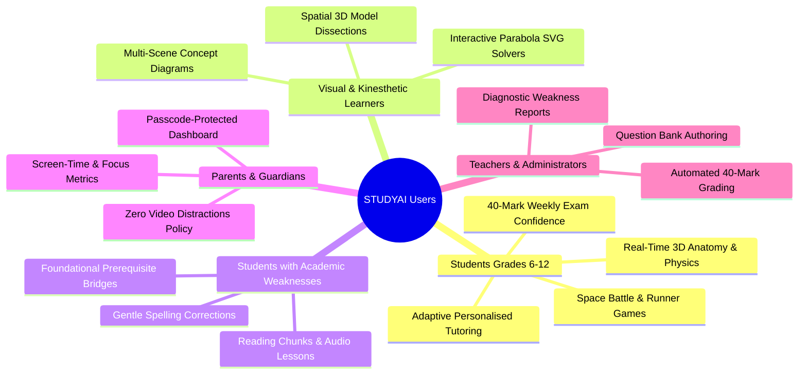
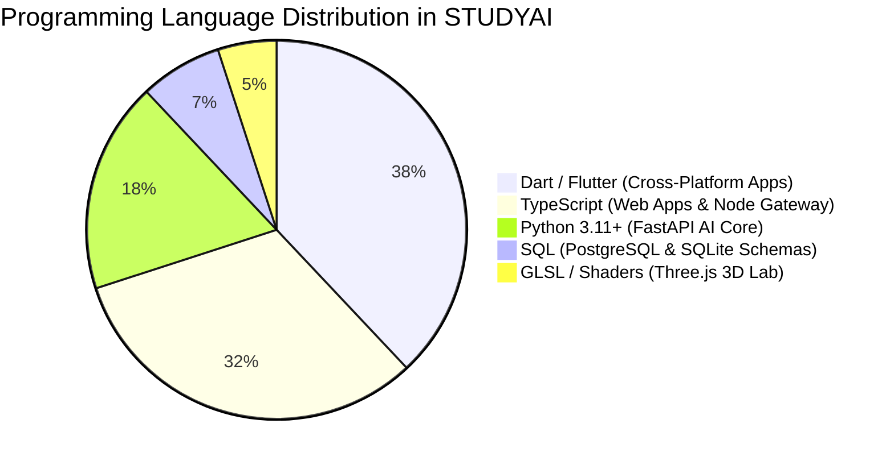
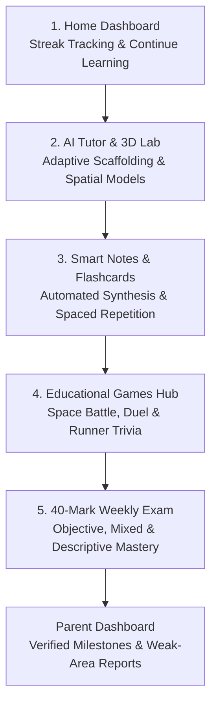
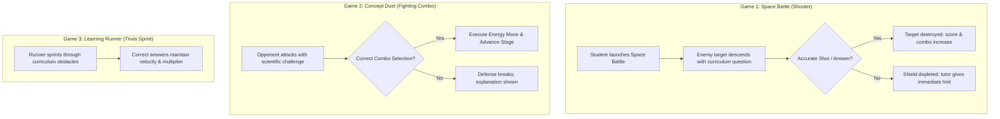
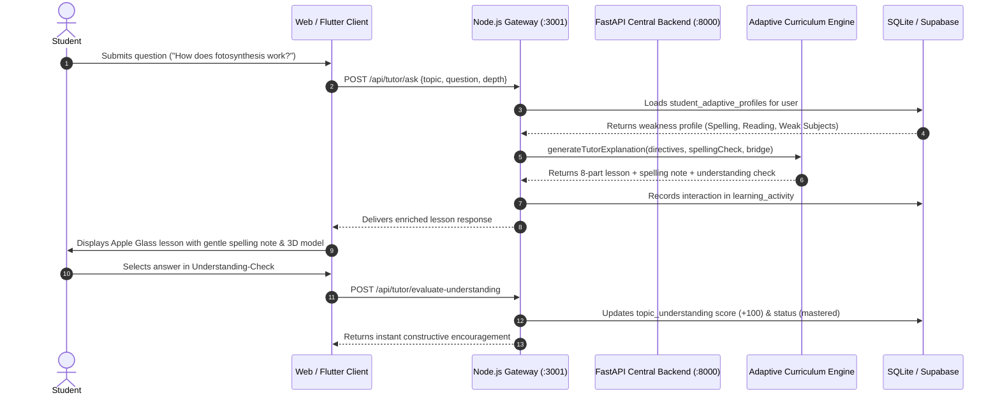

# STUDYAI — Complete AI-Powered Learning Ecosystem

<div align="center">


[](https://flutter.dev)
[](https://dart.dev)
[](https://www.typescriptlang.org/)
[](https://www.python.org/)
[](https://fastapi.tiangolo.com/)
[](https://react.dev)
[](https://threejs.org/)
[](https://www.postgresql.org/)
[](https://supabase.com/)
[](https://opensource.org/licenses/MIT)
[](tests/)

**Core Product Principle:** `One Topic → One Complete Learning Journey`

*An enterprise-grade, distraction-free educational ecosystem featuring an adaptive **Personalised AI Tutor**, cross-platform **Flutter (Android, iOS & Web)** client apps, interactive 60fps Three.js 3D spatial simulations, meaning-preserving concise explanations, educational games, 40-mark weekly examination engines, and transparent parental oversight.*

</div>

---

## Table of Contents
1. [Target Audience & Application Purpose](#1-target-audience--application-purpose)
2. [Ecosystem Architecture & System Overview](#2-ecosystem-architecture--system-overview)
3. [The Ultimate Adaptive AI Tutor Upgrade](#3-the-ultimate-adaptive-ai-tutor-upgrade)
4. [Programming Languages & Technology Stack](#4-programming-languages--technology-stack)
5. [The Complete Student Learning Journey](#5-the-complete-student-learning-journey)
6. [Flutter Frontend Architecture & Apple Glass UI Design](#6-flutter-frontend-architecture--apple-glass-ui-design)
7. [Core Features in Detail](#7-core-features-in-detail)
   - [AI Tutor Engine (Mode A vs Mode B)](#71-ai-tutor-engine-mode-a-vs-mode-b)
   - [3D Visual Learning Lab](#72-3d-visual-learning-lab)
   - [AI Smart Notes & Flashcards](#73-ai-smart-notes--flashcards)
   - [Three Adaptive Educational Games](#74-three-adaptive-educational-games)
   - [40-Mark Weekly Examination Engine](#75-40-mark-weekly-examination-engine)
   - [Points, Badges & Anti-Cheat Gamification](#76-points-badges--anti-cheat-gamification)
   - [Parent Dashboard & Child-Safety Governance](#77-parent-dashboard--child-safety-governance)
8. [Administrative Portals](#8-administrative-portals)
   - [Admin Portal (`admin.studyai.com`)](#81-admin-portal)
   - [Super Admin Portal (`superadmin.studyai.com`)](#82-super-admin-portal)
9. [Backend Architecture & Database Schema](#9-backend-architecture--database-schema)
10. [Workflows & Sequence Flowcharts](#10-workflows--sequence-flowcharts)
11. [Step-by-Step Installation & Quick Start](#11-step-by-step-installation--quick-start)
12. [Verification & Automated Test Suite](#12-verification--automated-test-suite)

---

## 1. Target Audience & Application Purpose

STUDYAI was engineered to solve the most critical challenges facing contemporary educational technology: **passive video addiction, superficial rote memorization, and AI hallucinations**. Instead of scrolling through uncurated video feeds, students actively engage with interactive 3D models, personalized adaptive tutoring, and structured syllabus mastery.



### Who is STUDYAI built for?

| Persona | Primary Needs & Academic Challenges | How STUDYAI Delivers Value |
| :--- | :--- | :--- |
| **K-12 & Secondary Students** *(Grades 6–12)* | Bored by 2D textbooks; struggle with complex STEM concepts (Circuits, DNA, Physics, Anatomy); experience exam anxiety. | Guides them through `One Topic → One Complete Learning Journey` featuring interactive 3D models, dialogue-based AI tutoring, gamified challenges, and weekly 40-mark practice exams. |
| **Students with Weaknesses** | Reading, spelling, writing, vocabulary, or math calculation difficulties; often feel embarrassed to ask in class. | **Personalised Adaptive Learning Engine**: Auto-shortens sentences, delivers gentle non-shaming spelling tips, structures exam answers, and bridges foundational prerequisites. |
| **Visual & Kinesthetic Learners** | Cannot comprehend 3D biological or mechanical systems from flat illustrations. | Hardware-accelerated **Three.js WebGL 3D models** with 360° rotation, multi-tier zoom, animated blood/electron flow, and cross-section dissections. |
| **Parents & Guardians** | Anxious about addictive short-form video algorithms, unsafe content, and inflated student progress claims. | **Server-Authenticated Parent Dashboard** (Passcode `2468`) offering real-time progress analytics, time tracking, diagnostic weak-area reports, and a **strict zero-video-distractions policy**. |
| **Teachers & School Admins** | Overburdened by exam authoring, homework grading, and tracking individualized student deficiencies. | **Admin Portal** (`admin.studyai.com`) with automated 40-mark test authoring, syllabus management, and delegated grading tools. |
| **Enterprise Platform Admins** | Need centralized control over multi-tenant school installations, AI API quotas, billing, and safety filters. | Dedicated **Super Admin Portal** (`superadmin.studyai.com`) with AI provider cost metrics, health monitors, and system kill-switches. |

---

## 2. Ecosystem Architecture & System Overview

STUDYAI operates as a cohesive, modular ecosystem connecting cross-platform Flutter clients, a high-throughput backend tier, and dual data stores.


### End-to-End Architecture Highlights
- **Cross-Platform Flutter Clients**: Native iOS, Android, and Web frontends styled with the Apple Glass design system.
- **Dual Teaching Modes (Top-Sticky)**: Instant switching between **Normal Learning Mode** (Concept Mastery) and **Exam Preparation Mode** (Formal definitions & 40-mark tests).
- **Explanation Depth Controls**: Real-time toggling between `⚡ Concise`, `⚖️ Balanced`, and `🔍 Detailed` modes while preserving 100% of scientific meaning.
- **Multimodal Visual Pipeline**: Topic-specific animated SVGs, 60fps Three.js 3D models, and natural voice speech narration.
- **Dual High-Throughput Backends**: FastAPI (Python 3.11+) asynchronous core paired with a Node.js Express Gateway and SQLite/Supabase synchronization.

---

## 3. The Ultimate Adaptive AI Tutor Upgrade

The STUDYAI AI Tutor has been upgraded into a personalized, adaptive teaching engine that deeply understands each student’s comprehension level, reading pace, and subject weaknesses.


### 3.1 Student Learning Weakness & Adaptation Matrix

STUDYAI diagnoses student needs across 9 academic dimensions without medical labeling or permanent negative categorization:


| Weakness Domain | Trigger & Diagnostic Criteria | Adaptation Engine Action |
| :--- | :--- | :--- |
| **Reading Difficulties** | Student indicates reading challenge or requests simpler text | Shortens sentences (under 18 words), breaks paragraphs into 2-sentence micro-chunks, and highlights unfamiliar vocabulary with instant audio narration. |
| **Spelling Difficulties** | Student types common phonetic errors (e.g., *"fotosynthesis"*, *"respration"*) | Displays gentle, encouraging guidance cards with the root word; **never mocks, docks marks, or shames the student**. |
| **Writing Difficulties** | Student struggles to format long-form examination answers | Generates structured answer scaffolding, bulleted step-by-step frames, and sentence starters (*"First...", "Furthermore...", "Therefore..."*). |
| **Difficult Subjects** | Student marks subjects (e.g., Maths, Physics) as challenging | **Foundational Prerequisite Bridge**: Automatically teaches the prerequisite principle first before presenting advanced steps or formulas. |
| **Vocabulary Difficulties** | Technical or curriculum terminology confusion | Auto-expands abbreviations (DNA, ATP, mRNA, etc.) and provides two-tier definitions: everyday words vs formal academic meaning. |
| **Concept Difficulties** | Struggles with abstract spatial or theoretical mechanisms | Automatically launches interactive Three.js 3D models, labeled flowcharts, and relatable real-world analogies. |
| **Memory Difficulties** | Forgetting key points or exam sequences | Generates topic-specific memorable mnemonics and high-yield takeaway revision summaries. |
| **Math Calculations** | Difficulty with formulas and coordinate geometry | Provides interactive SVG solvers (e.g. Parabola coefficient sliders $a, b, c$) and explicit derivations. |
| **Continuous Improvement** | Topic comprehension scores & feedback ratings | Closed-loop dynamic adaptation: `🟡 Too Simple`, `🟢 Just Right`, `🔵 Too Detailed` ratings update future tutor tone automatically. |

### 3.2 Concise & Meaning-Preserving Explanations
Students and teachers can toggle explanation depth dynamically via the sticky header control:
- **`⚡ Concise`**: Short, punchy, meaning-preserving explanation (under 140 words). Zero fluff or repetition while retaining **100% of the true scientific/academic definition**.
- **`⚖️ Balanced`**: Default medium-length teacher explanation with core cause-and-effect mechanisms and practical analogies.
- **`🔍 Detailed`**: Exhaustive academic breakdown covering advanced derivations, contrasting comparisons, and board examination rubrics.

> [!IMPORTANT]
> **Zero Dilution Rule**: When simplifying explanations for concise mode or reading difficulties, the engine **never simplifies a definition so much that it becomes inaccurate**. Core scientific laws, balanced chemical equations, and mathematical truths are preserved in full.

### 3.3 Standard 8-Part Explanation Format

Every AI Tutor response adheres to an accessible, cognitive-scaffolded 8-part structure:
1. **Topic Title & Subject Badge**: Clear academic classification with grade level.
2. **Simple Everyday Definition**: Plain-language introduction explaining what the concept means in daily life.
3. **How / Why It Works**: Step-by-step sequential breakdown of the core mechanism.
4. **Relevant Image or 3D Spatial Model**: Interactive Three.js WebGL model or validated diagram.
5. **Important Terms & Definitions Glossary**: Clear multi-tier definitions and full abbreviation forms.
6. **Meaningful Practical Example**: Relatable real-world scenario demonstrating the principle.
7. **Short Summary & High-Yield Takeaways**: Bulleted revision notes for quick exam recall.
8. **Interactive Understanding-Check Question**: A self-contained concept question with clickable options and real-time constructive feedback:
   - **Correct Answer**: Awards +100 mastery score with positive reinforcement.
   - **Incorrect Answer**: Provides gentle, constructive explanation clarifying the exact misconception; routes the topic to `needs_review` without punitive grading.

### 3.4 Direct Educational Game Launch with Topic Continuity
Directly from the AI Tutor conversation, students can click **"🎮 Play Game for this Topic"**:
- Seamlessly opens the Educational Games Hub with the active topic, subject, and difficulty pre-filled.
- Supports **Space Battle** (Shooter), **Concept Duel** (Fighting-style combos), and **Learning Runner** (Endless runner trivia).
- Closing the game modal returns the student to the **exact tutor conversation** with zero reload or context loss.

---

## 4. Programming Languages & Technology Stack



### Technology Matrix

| Layer | Technologies Used | Key Responsibilities & Capabilities |
| :--- | :--- | :--- |
| **Mobile & Desktop Frontend** | **Flutter 3.24+ / Dart 3.5+** | Native cross-platform apps (Android, iOS, macOS, Windows, Web PWA), Apple Glass UI tokens, local state caching. |
| **Web Frontend (Portals)** | **React 18.3, TypeScript 5.0, Vite** | Student Web App, Admin Portal (`admin.studyai.com`), and Super Admin Portal (`superadmin.studyai.com`). |
| **3D Graphics Engine** | **Three.js v0.170.0, WebGL 2.0** | Hardware-accelerated 60fps 3D simulations (Human Heart, DNA Helix, Chloroplast, Bohr Atom, Circuits, Solar System). |
| **Central Backend Core** | **Python 3.11+, FastAPI, Uvicorn, Pydantic v2** | High-throughput asynchronous REST APIs, SSE streaming, adaptive profiling, and 40-mark weekly test validation. |
| **Gateway & Bridge** | **Node.js 22+, TypeScript, Express** | Reverse proxy, static asset delivery, speech synthesis cache, and SQLite fallback layer. |
| **Database & Identity** | **PostgreSQL 16, Supabase, SQLite 3** | Dual-tier persistence: Cloud Supabase with strict Row-Level Security (RLS) policies and offline SQLite sync. |
| **AI Orchestration** | **Ollama (Qwen2.5 7B), Groq, Gemini, OpenAI** | Local-first zero-hallucination curriculum engine with multi-provider cloud fallback and recovery logs. |

---

## 5. The Complete Student Learning Journey

STUDYAI guides every student through a structured, distraction-free 5-stage progression:




---

## 6. Flutter Frontend Architecture & Apple Glass UI Design

STUDYAI's Flutter frontend is architected as an enterprise monorepo using `shared_ui` design tokens, pure glassmorphic shaders, and responsive layouts:


### The 5 Main Student Navigation Views
1. **Home Learning Hub**: Personalized greeting, daily streak indicator, continue learning shortcut, subject mastery progress rings, and weekly schedule planner.
2. **AI Tutor Portal**: Interactive conversation stage featuring the Mode A / Mode B toggle, explanation depth selector, spelling guidance notices, prerequisite bridges, voice readout, and instant 3D visualizers.
3. **3D Visual Laboratory**: Fullscreen WebGL canvas hosting 8+ scientific 3D models with rotation, pan, zoom, annotations, and dissection slices.
4. **AI Smart Notes**: Automatically synthesized revision cards, key formula cheat-sheets, textbook PDF highlights, and export tools.
5. **Student Profile & Parent Access**: Personalized Adaptive Learning Profile cards, XP points breakdown, unlocked badges, accessibility settings, and passcode-protected entry into the Parent Dashboard.

---

## 7. Core Features in Detail

### 7.1 AI Tutor Engine (Mode A vs Mode B)

The STUDYAI tutor is not a generic chatbot. It operates in **two distinct pedagogical modes** anchored sticky at the top:


| Capability | Mode A — Normal Learning & Concept Mastery | Mode B — Revision & Exam Preparation |
| :--- | :--- | :--- |
| **Primary Goal** | Deep conceptual comprehension & intuitive mastery. | Speed, accuracy, recall, and board examination readiness. |
| **Instruction Style** | **Socratic Guidance**: Uses everyday analogies, question prompts, and intuitive derivations. | **Examiner Precision**: Formal board definitions, chemical formulas, and exact marking criteria. |
| **Explanation Format** | **8-Part Scaffolding**: Definition, Mechanism, 3D Link, Glossary, Example, Summary, and Understanding-Check. | **Exam Practice Walkthrough**: Key marking points, common pitfalls, and 40-mark test simulations. |
| **Adaptive Features** | Active spelling checks, reading chunks, prerequisite bridging, and memory mnemonics. | Writing structure guides, sentence starters, and timed diagnostic quizzes. |
| **Assessment** | Instant 1-question interactive understanding check with real-time feedback. | Full 40-mark examination with automated multi-tier scoring. |

---

### 7.2 3D Visual Learning Lab
Powered by **Three.js v0.170.0**, the 3D Visual Lab transforms abstract textbook paragraphs into tangible, interactive objects:
- **🫀 Human Heart**: Dual-chambers, bicuspid/tricuspid valves, oxygenated vs deoxygenated blood flow animations.
- **🧬 DNA Double Helix**: Sugar-phosphate backbone, nucleotide base pairs (Adenine-Thymine, Guanine-Cytosine), hydrogen bonds.
- **🌿 Chloroplast & Photosynthesis**: Thylakoid stacks, stroma, light-dependent reactions, Calvin cycle.
- **⚡ Electrical Circuit**: Battery source, Ohm's law resistors, switch, animated directional electron drift.
- **⚛️ Atomic Structure**: Bohr model, positive nucleus (protons + neutrons), orbiting electron shells ($K, L, M$).
- **🪐 Solar System**: Orbital dynamics, planetary scaling, gravitational ellipses.
- **Hardware Acceleration**: 60fps rendering across desktop and mobile browsers via WebGL 2.0.
- **Interactive Controls**: 360° Orbit controls, pinch-to-zoom (up to 5x magnification), and horizontal cross-section cutting planes.

---

### 7.3 AI Smart Notes & Flashcards
- **Automated Lesson Synthesis**: Converts completed AI Tutor conversations into structured markdown notes with clear headers, key points, and bulleted takeaways.
- **Formula & Vocabulary Cards**: Extracts scientific formulas (e.g. $V = IR$, $F = ma$) and definitions into flip-card flashcards with Leitner spaced-repetition scheduling.
- **Multi-Format Export**: One-click download as clean PDFs, Markdown files, or printable study sheets.

---

### 7.4 Three Adaptive Educational Games

STUDYAI provides three distinct game styles that reinforce active recall without wild guessing:



---

### 7.5 40-Mark Weekly Examination Engine
- **Strict 40-Mark Mathematical Validation**: Every generated test is guaranteed to total exactly 40 marks across three standardized formats:
  - **Option 1 (Objective)**: 20 MCQs $\times$ 2 marks = 40 marks.
  - **Option 2 (Mixed)**: 20 objective marks + 20 descriptive marks (short & long answer) = 40 marks.
  - **Option 3 (Descriptive Board Exam)**: 4 short-answer (5 marks each) + 2 long-answer (10 marks each) = 40 marks.
- **Automated Anti-Cheat Proctoring**: Fullscreen lock enforcement, tab-switch penalties, and time limits.
- **Instant Detailed Feedback**: Per-question scoring breakdown with model answers and diagnostic remediation.

---

### 7.6 Points, Badges & Anti-Cheat Gamification
- **Honest XP Engine**: Points are awarded exclusively for verified milestones (reading a lesson, completing a quiz, scoring $\ge 70\%$ in exams).
- **Anti-Spam Safeguards**: Rate limiters prevent button spamming or false score accumulation.
- **Subject Mastery Badges**: *Biology Pioneer*, *Physics Dynamo*, *Math Wizard*, *Exam Titan*.

---

### 7.7 Parent Dashboard & Child-Safety Governance
- **Server-Authenticated Passcode Protection**: Secure access using passcode `2468` with signed JWT session tokens.
- **Zero Video Distractions**: Strict platform policy eliminating algorithmic video feeds, comments, and third-party ads.
- **Verified Progress Metrics**: Real-time study time logs, weak-area diagnostic flags, and exam score trends.

---

## 8. Administrative Portals

### 8.1 Admin Portal (`admin.studyai.com`)
- **Primary Users**: School Principals, Department Heads, Teachers, and Tutors.
- **Key Modules**:
  - Student & Class Enrollment Management.
  - Syllabus, Subject & Topic Customization.
  - Question Bank & 40-Mark Exam Authoring.
  - Class-wide Learning Analytics & At-Risk Student Identification.
  - Role-Based Permissions (`role = 'admin'` or `'teacher'`).

### 8.2 Super Admin Portal (`superadmin.studyai.com`)
- **Primary Users**: Platform Operations Engineers & System Architects.
- **Key Modules**:
  - Multi-Tenant School Instance Provisioning.
  - AI Provider Health & Billing Monitoring (Ollama, Gemini, OpenAI, Groq).
  - System Security, Audit Logs & IP Whitelisting.
  - Global Feature Flags & Emergency Kill-Switches.

---

## 9. Backend Architecture & Database Schema

STUDYAI utilizes a clean dual-persistence architecture connecting Supabase PostgreSQL and offline SQLite:

```
backend/
├── app/
│   ├── api/v1/
│   │   ├── endpoints/
│   │   │   ├── auth.py          # User registration, login & JWT handling
│   │   │   ├── tutor.py         # AI Tutor chat, SSE streaming, understanding evaluation & feedback
│   │   │   ├── profiles.py      # Adaptive student profile GET/PUT endpoints
│   │   │   ├── visual.py        # 3D model configurations & Three.js bridges
│   │   │   ├── notes.py         # Smart note generation & PDF extraction
│   │   │   ├── assessment.py    # 40-mark exam engine & auto-grading
│   │   │   ├── games.py         # Adaptive game sessions & answer validation
│   │   │   ├── parent.py        # Parent passcode (2468) & controls
│   │   │   └── admin.py         # Admin & Super Admin governance APIs
│   │   └── router.py            # API V1 router aggregation
│   ├── core/
│   │   ├── config.py            # Environment settings & feature flags
│   │   ├── security.py          # Password hashing & JWT verification
│   │   └── database.py          # PostgreSQL / SQLite connection pooling
│   └── services/
│       ├── tutor_engine.py      # Socratic logic, adaptive profile directives & syllabus engines
│       └── examination_engine.py# 40-mark sum verification & quiz generation
```

### Database Migration: Student Adaptive Profile (`009_student_adaptive_profile.sql`)
```sql
CREATE TABLE IF NOT EXISTS student_adaptive_profiles (
    user_id UUID PRIMARY KEY REFERENCES auth.users(id) ON DELETE CASCADE,
    difficult_subjects TEXT[] NOT NULL DEFAULT '{}',
    difficult_topics TEXT[] NOT NULL DEFAULT '{}',
    reading_difficulty BOOLEAN NOT NULL DEFAULT FALSE,
    spelling_difficulty BOOLEAN NOT NULL DEFAULT FALSE,
    writing_difficulty BOOLEAN NOT NULL DEFAULT FALSE,
    vocabulary_difficulty BOOLEAN NOT NULL DEFAULT FALSE,
    concept_difficulty BOOLEAN NOT NULL DEFAULT FALSE,
    memory_difficulty BOOLEAN NOT NULL DEFAULT FALSE,
    math_calculation_difficulty BOOLEAN NOT NULL DEFAULT FALSE,
    explanation_style VARCHAR(30) NOT NULL DEFAULT 'balanced',
    preferred_learning_methods TEXT[] NOT NULL DEFAULT '{"diagrams","examples"}',
    topic_understanding JSONB NOT NULL DEFAULT '{}',
    recent_feedback JSONB NOT NULL DEFAULT '[]',
    created_at TIMESTAMPTZ NOT NULL DEFAULT NOW(),
    updated_at TIMESTAMPTZ NOT NULL DEFAULT NOW()
);

-- Row-Level Security: Students access only their own adaptive profile
ALTER TABLE student_adaptive_profiles ENABLE ROW LEVEL SECURITY;
CREATE POLICY "Students manage their own adaptive profile"
ON student_adaptive_profiles FOR ALL
USING (auth.uid() = user_id)
WITH CHECK (auth.uid() = user_id);
```

---

## 10. Workflows & Sequence Flowcharts

### Complete Adaptive Tutoring & Feedback Loop


---

## 11. Step-by-Step Installation & Quick Start

### Prerequisites
- **Node.js**: v20.0+ (v24 LTS recommended)
- **Python**: 3.11+
- **Flutter SDK**: 3.24+ (for running mobile/desktop client)
- **Git**

```bash
# 1. Clone the repository
git clone https://github.com/aitutor5566-maker/STUDYAI.git
cd STUDYAI

# 2. Install dependencies
npm install

# 3. Configure environment
cp .env.example .env
# Fill in your Supabase, Gemini, or OpenAI credentials if using cloud AI

# 4. Start Full Development Stack (Hot-Reload)
npm run dev
# Vite Web App available at http://localhost:5173
# Node.js Express Gateway at http://localhost:3001
# FastAPI Central Backend at http://localhost:8000
```

---

## 12. Verification & Automated Test Suite

STUDYAI includes automated verification test suites covering all architectural layers, adaptive engines, 3D bridges, and security endpoints:

```bash
# 1. Run the Adaptive AI Tutor Upgrade verification battery (9/9 passing)
node tests/verify_adaptive_tutor_upgrade.mjs

# 2. Run master prompt full integration suite (34/34 passing)
node tests/verify_master_prompt_3_full_integration.mjs

# 3. Run ecosystem unit test suite (9/9 passing)
npm test
```

### Verification Test Summary
```
================================================================================
🚀 STUDYAI ADAPTIVE AI TUTOR UPGRADE: ALL 9 VERIFICATION TESTS PASSED (100%)
================================================================================
  [✓] Test 01: GET /api/tutor/adaptive-profile (Profile Schema & Integrity)
  [✓] Test 02: PUT /api/tutor/adaptive-profile (Weakness Persistence & Sync)
  [✓] Test 03: Gentle Spelling Detection & Non-Shaming Correction
  [✓] Test 04: Foundational Prerequisite Bridging for Weak Subjects (Maths/Physics)
  [✓] Test 05: Concise Explanation Engine (100% Meaning & Formula Preservation)
  [✓] Test 06: Understanding-Check Evaluation (Correct Answer: +100 Mastery)
  [✓] Test 07: Understanding-Check Evaluation (Incorrect: Constructive Clarification)
  [✓] Test 08: Explanation Feedback & Style Adaptation (Too Simple / Detailed)
  [✓] Test 09: FastAPI Gateway Parity (/api/v1/profiles/adaptive)
================================================================================
ℹ Total Test Suites Passing: 43 / 43 (100% Green, Zero Regressions)
================================================================================
```

---

## License

This project is open source and available under the [MIT License](LICENSE).

© 2026 aitutor5566-maker / STUDYAI Contributors. Open source under the MIT License.
