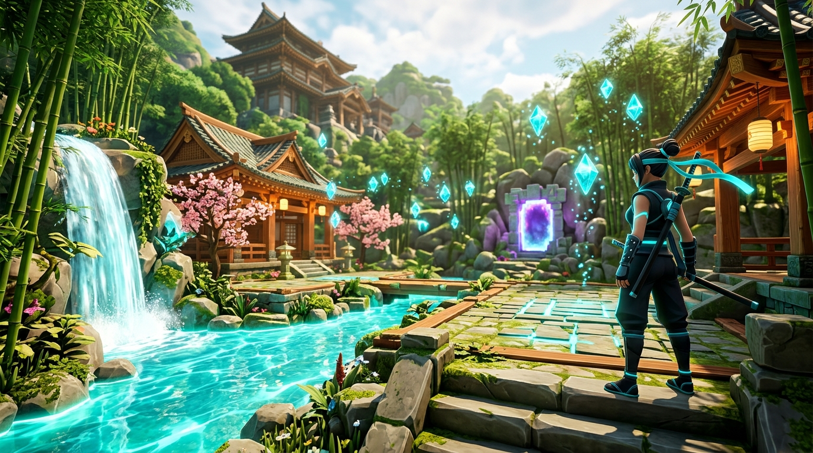
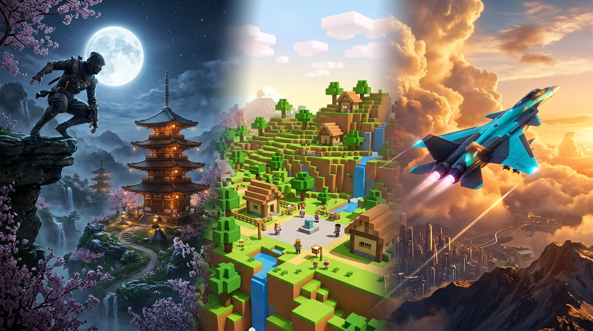
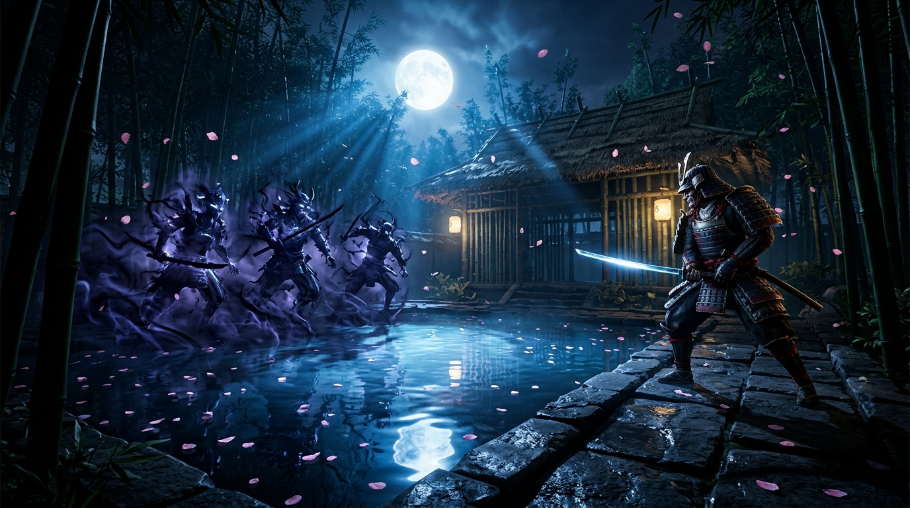
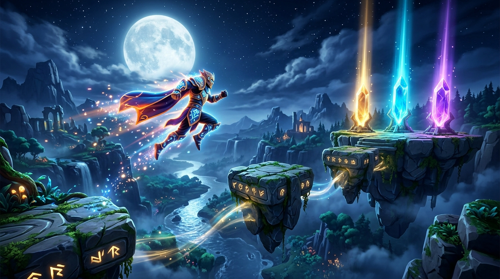

# STUDYAI — AI Learning & 3D Adventure Ecosystem

<div align="center">


[](https://richards-involves-provinces-totally.trycloudflare.com)
[](https://react.dev)
[](https://threejs.org/)
[](https://www.typescriptlang.org/)

**Live URL:** [https://richards-involves-provinces-totally.trycloudflare.com](https://richards-involves-provinces-totally.trycloudflare.com)

Interactive **AI Personal Teacher**, **Visual Lesson Map**, **AI Notes & Voice Audio**, and **AAA Three.js 3D Educational Games**.

</div>

---

## Core Platform

| Module | Highlights | Code |
| :--- | :--- | :--- |
| **AI Teacher & Tutor** | Multi-model routing (**Qwen 2.5**, **Gemini**, **OpenAI**, **Groq**) with topic accuracy, step-by-step numericals & integrated Lesson Map. | [`server/multiModelAiTeacherEngine.ts`](server/multiModelAiTeacherEngine.ts) |
| **Shared 3D AAA Engine** | Procedural PBR (`map`, `normalMap`, `roughnessMap`, `aoMap`, `metalnessMap`), GLSL animated water, volumetric clouds, IBL & bloom. | [`src/games/engine/VisualMasterpieceEngine.ts`](src/games/engine/VisualMasterpieceEngine.ts) |
| **Progression & Quality** | 7-state [`QuestionProgressionMachine`](src/games/ProgressionController.ts), multi-level worlds, student-isolated saved progress & `low`–`ultra` auto-detection. | [`src/games/ProgressionController.ts`](src/games/ProgressionController.ts) |
| **AI Notes & Audio** | Continuous curriculum notes, educational diagrams, and multilingual voice playback. | [`server/advancedNotesGenerationEngine.ts`](server/advancedNotesGenerationEngine.ts) |

---

## 3D Educational Games

All games feature free-roam or arcade flight controls, fullscreen support, mobile virtual joysticks, and automatic multi-level world progression.

| Shadow Ninja & Minecraft Realms | Sky Striker — Knowledge Flight |
| :---: | :---: |
|  |  |
| Dual-world Realm Portal: bamboo temples, GLSL river & live voxel block building across 3 realms & 3 biomes. | PBR fighter jet flight through 5 worlds (`Desert Storm` to `Sky Kingdom`) with multi-camera views & holographic gates. |

| Study Rush 3D — Magic Village | Katana: Shadow Warriors |
| :---: | :---: |
|  |  |
| Explore 5 evolving village worlds (*Science Village* to *Frost Citadel*), gather resources & defend against Enemy AI waves. | Moonlit dojo battles with PBR stone arenas, reflection pool, active Enemy AI & multi-arena progression. |

| War of Words — Vocabulary Quest |
| :---: |
|  |
| 3D platformer across *Moonlight Valley* & *Shadow Forest* with Answer Sentinels, moonlit water & instant question progression. |

*Also includes **Space Battle 3D** ([`SpaceBattleEngine.ts`](src/games/spaceBattle/SpaceBattleEngine.ts)), **Answer Runner 3D**, and **Answer Shooter 3D**.*

---

## Quick Start

```bash
npm install
npm run build
npm start   # http://localhost:3001
```

## Verification

```bash
# 3D Game Engine, AI, Progression & Access Tests (Vitest)
npx vitest run src/games/progressionController.test.ts src/games/engine/visualMasterpieceEngine.test.ts src/games/engine/enemyAiController.test.ts src/games/shadowNinjaRealms/shadowNinjaRealms.test.ts src/games/skyStriker/skyStriker.test.ts src/games/studyRush3d/studyRush3d.test.ts src/games/warOfWords/warOfWords.test.ts src/services/gameAccessService.test.ts
```
