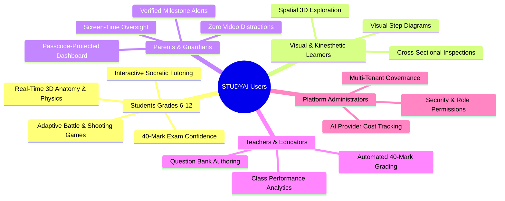
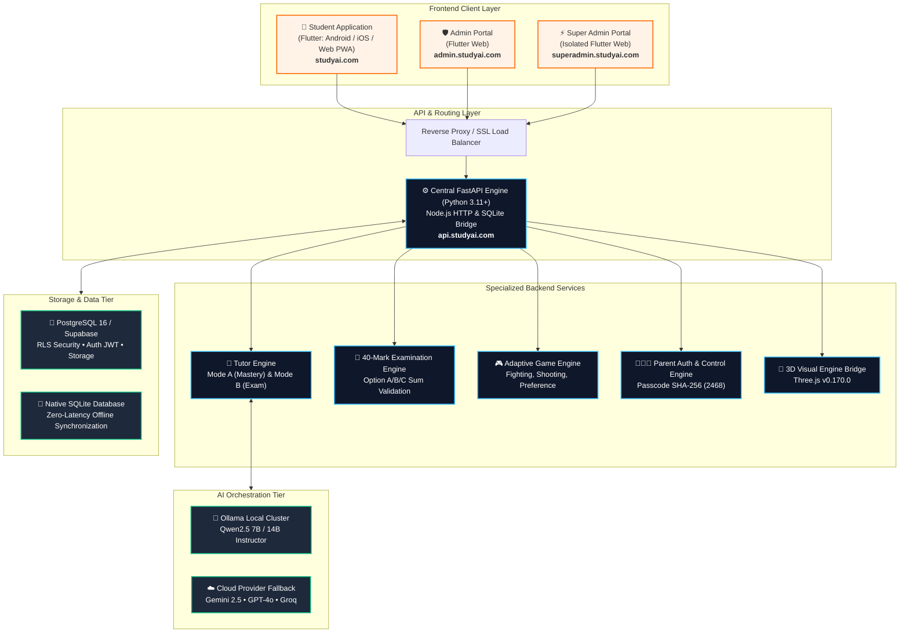
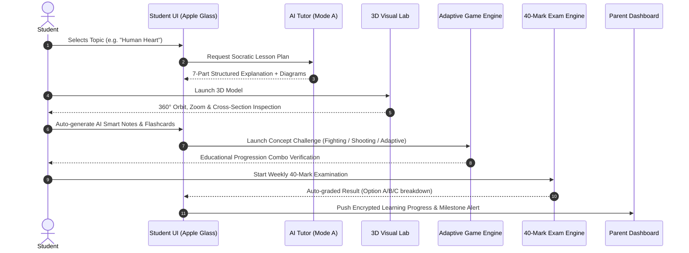
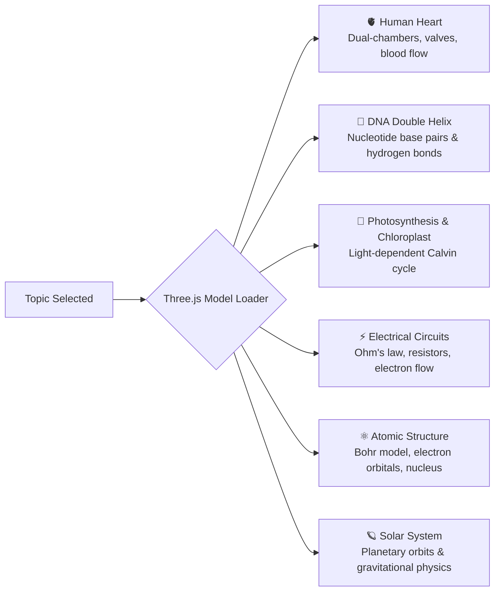
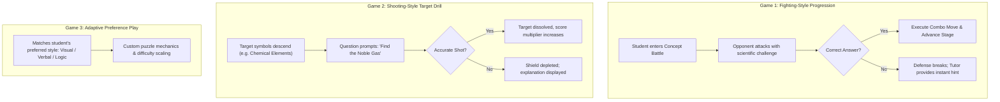
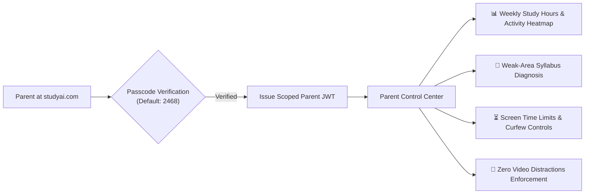
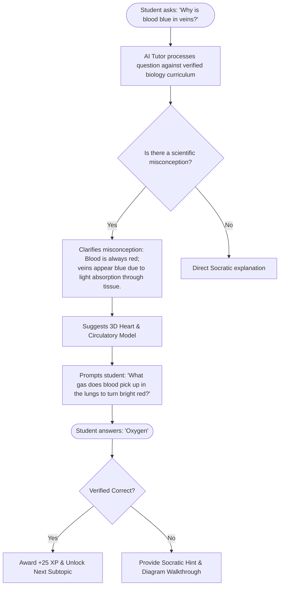

# STUDYAI — Complete AI-Powered Learning Ecosystem

<div align="center">


[](https://flutter.dev)
[](https://dart.dev)
[](https://www.typescriptlang.org/)
[](https://www.python.org/)
[](https://fastapi.tiangolo.com/)
[](https://react.dev)
[](https://threejs.org/)
[](https://www.postgresql.org/)
[](https://supabase.com/)
[](#license)
[](tests/)

**Core Product Principle:** `One Topic → One Complete Learning Journey`

*An enterprise-grade, distraction-free educational ecosystem with a cross-platform **Flutter (Android, iOS & Web)** frontend, Socratic AI tutoring, interactive 60fps Three.js 3D simulations, adaptive educational games, 40-mark weekly examination engines, and transparent parental oversight.*

</div>

---

## Table of Contents
1. [Target Audience & Application Purpose](#1-target-audience--application-purpose)
2. [Ecosystem Architecture & System Overview](#2-ecosystem-architecture--system-overview)
3. [Programming Languages & Technology Stack](#3-programming-languages--technology-stack)
4. [The Complete Student Learning Journey](#4-the-complete-student-learning-journey)
5. [Flutter Frontend Architecture & Apple Glass UI Design](#5-flutter-frontend-architecture--apple-glass-ui-design)
6. [Core Features in Detail](#6-core-features-in-detail)
   - [AI Tutor Engine (Mode A & Mode B)](#61-ai-tutor-engine-mode-a-vs-mode-b)
   - [3D Visual Learning Lab](#62-3d-visual-learning-lab)
   - [AI Smart Notes & Flashcards](#63-ai-smart-notes--flashcards)
   - [Three Adaptive Educational Games](#64-three-adaptive-educational-games)
   - [40-Mark Weekly Examination Engine](#65-40-mark-weekly-examination-engine)
   - [Points, Badges & Anti-Cheat Gamification](#66-points-badges--anti-cheat-gamification)
   - [Parent Dashboard & Child-Safety Governance](#67-parent-dashboard--child-safety-governance)
7. [Administrative Portals](#7-administrative-portals)
   - [Admin Portal (`admin.studyai.com`)](#71-admin-portal)
   - [Super Admin Portal (`superadmin.studyai.com`)](#72-super-admin-portal)
8. [Backend Architecture & Data Integrity](#8-backend-architecture--data-integrity)
9. [Workflows & Sequence Flowcharts](#9-workflows--sequence-flowcharts)
10. [Step-by-Step Installation & Quick Start](#10-step-by-step-installation--quick-start)
11. [Verification & Automated Test Suite](#11-verification--automated-test-suite)

---

## 1. Target Audience & Application Purpose

STUDYAI was engineered to solve the most critical challenges facing contemporary educational technology: **passive video addiction, superficial rote memorization, and AI hallucinations**. Instead of scrolling through uncurated video feeds, students actively engage with interactive 3D models, Socratic inquiry, and structured syllabus mastery.



### Who is STUDYAI built for?

| Persona | Primary Needs & Pain Points | How STUDYAI Delivers Value |
| :--- | :--- | :--- |
| **K-12 & Secondary Students** *(Grades 6–12)* | Bored by 2D textbooks; struggle with complex STEM concepts (Circuits, DNA, Physics, Anatomy); experience exam anxiety. | Guides them through `One Topic → One Complete Learning Journey` featuring interactive 3D models, dialogue-based AI tutoring, gamified challenges, and weekly 40-mark practice exams. |
| **Visual & Kinesthetic Learners** | Cannot comprehend 3D biological or mechanical systems from flat illustrations. | Provides hardware-accelerated **Three.js WebGL 3D models** with 360° rotation, multi-tier zoom, animated blood/electron flow, and cross-section dissections. |
| **Parents & Guardians** | Anxious about addictive short-form video algorithms, unsafe content, and inflated student progress claims. | Features a **Server-Authenticated Parent Dashboard** (Passcode `2468`) offering real-time progress analytics, time tracking, diagnostic weak-area reports, and a **strict zero-video-distractions policy**. |
| **Teachers & School Admins** | Overburdened by exam authoring, homework grading, and tracking individualized student deficiencies. | Provides the **Admin Portal** (`admin.studyai.com`) with automated 40-mark test authoring, syllabus management, and delegated grading tools. |
| **Enterprise Platform Admins** | Need centralized control over multi-tenant school installations, AI API quotas, billing, and safety filters. | Dedicated **Super Admin Portal** (`superadmin.studyai.com`) with AI provider cost metrics, health monitors, and system kill-switches. |

---

## 2. Ecosystem Architecture & System Overview

STUDYAI operates as a cohesive, modular ecosystem connecting three client applications, a high-throughput backend tier, and dual data stores.


### End-to-End Architecture Diagram



---

## 3. Programming Languages & Technology Stack

Each programming language and framework within STUDYAI was selected for a precise architectural purpose:

| Language / Framework | Version | Primary Purpose in STUDYAI | Architectural Justification |
| :--- | :--- | :--- | :--- |
| **Dart** | `3.5+` | Student App & Admin Portals | Compiles natively to ARM64 machine code for 60fps mobile execution (Android & iOS) and high-performance WebAssembly/JS for web. |
| **Flutter** | `3.24+` | Multi-Platform UI Framework | Single unified codebase powering Apple Glass UI design across mobile, tablet, and web dashboards with Skia/Impeller hardware acceleration. |
| **Python** | `3.11+` | Backend & AI Orchestration | Standard in machine learning, NLP, and AI pipelines. Powers asynchronous FastAPI REST endpoints, Pydantic v2 validation, and Ollama integration. |
| **FastAPI** | `0.110+` | Central High-Throughput API | Asynchronous ASGI framework providing sub-millisecond route dispatch, auto-generated OpenAPI documentation, and SSE streaming for AI tutor responses. |
| **TypeScript** | `5.0+` | Full-Stack Web Engine & Three.js Bridge | Provides compile-time type safety across React 18 interfaces, Node.js SQLite bridge (`server/index.ts`), and 3D WebGL scenes (`visual_learning/three.js/`). |
| **JavaScript (ES2024)** | Modern | WebGL Canvas & Shader Bridges | Coordinates two-way message passing between Flutter host webviews and embedded Three.js canvases via `JavaScriptChannel` and `postMessage`. |
| **SQL** | PostgreSQL 16 & SQLite 3 | Enterprise & Offline Persistence | Strict relational ACID compliance, Supabase Row-Level Security (RLS) policies, and high-performance local SQLite caching for offline learning. |
| **HTML5 & CSS3** | Modern | Apple Glass Design System | Native CSS backdrop-filter glassmorphism, responsive grid layouts, custom font typography, and fluid SVG icon rendering. |
| **GLSL (OpenGL Shading)**| WebGL 2.0 | 3D Lighting & Cross-Sections | Custom vertex and fragment shaders for glowing biological membranes, anatomical blood flow, and electrical charge propagation in Three.js. |
| **Bash / Shell** | POSIX | DevOps & Automation | Unified testing scripts (`npm test`, `verify_*.mjs`), container orchestration, and automated GitHub CI/CD workflows. |

---

## 4. The Complete Student Learning Journey

STUDYAI adheres strictly to the **One Topic → One Complete Learning Journey** pedagogical methodology. Students do not jump erratically between disconnected videos; they progress systematically through seven structured learning phases:




---

## 5. Flutter Frontend Architecture & Apple Glass UI Design

The entire user interface across all three client applications is built using the **Flutter framework and the Dart programming language**. Flutter was chosen as the primary frontend engine to guarantee a 60fps hardware-accelerated user experience across Android, iOS, and Web from a single unified codebase.


### 5.1 Why Flutter & Dart Were Chosen for the Frontend

- **Multiplatform Single Codebase**: Write once, deploy natively to Android (`.apk`/`.aab`), iOS (`.ipa`), and modern Web (`studyai.com`, `admin.studyai.com`, `superadmin.studyai.com`).
- **Skia & Impeller Hardware Acceleration**: Delivers buttery-smooth 60fps animations for translucent glass cards, backdrop blurs, soft drop-shadows, and transitions without lag.
- **Declarative & Modular Widget Tree**: Enables clean separation of concerns using shared UI packages (`packages/shared_ui`) across Student, Admin, and Super Admin applications.
- **High-Performance 3D WebGL Bridge**: Integrates directly with Three.js via `flutter_studyai_visual` using bidirectional `JavaScriptChannel` (mobile) and window `postMessage` (web).
- **Responsive Screen Adaptation**: Custom `LayoutBuilder` automatically adapts the UI layout from single-column mobile view to two-pane tablet and multi-column desktop dashboard.

### 5.2 Flutter Monorepo Structure

```
apps/
├── student_app/                      # Flutter Student Application (Android / iOS / Web)
│   ├── lib/
│   │   ├── main.dart                 # Flutter entrypoint
│   │   ├── app.dart                  # MaterialApp configuration & theme injection
│   │   ├── state/
│   │   │   └── student_app_state.dart# Reactive state notifier
│   │   ├── screens/
│   │   │   ├── main_shell.dart       # Responsive shell with side-nav and bottom-bar
│   │   │   ├── home_screen.dart      # Learning hub, streaks & schedule
│   │   │   ├── tutor_screen.dart     # AI Tutor Mode A & Mode B conversation
│   │   │   ├── notes_screen.dart     # Smart notes editor & PDF export
│   │   │   ├── library_screen.dart   # Curriculum textbook & resources
│   │   │   └── profile_screen.dart   # Badges, XP & Parent Dashboard access
│   │   └── widgets/
│   │       ├── interactive_3d_dialog.dart # Flutter 3D Three.js modal
│   │       ├── continue_learning_card.dart
│   │       ├── activity_chart.dart
│   │       ├── upcoming_exam_card.dart
│   │       └── subject_card.dart
│   └── pubspec.yaml
├── admin_portal/                     # Flutter Web Application (admin.studyai.com)
│   ├── lib/
│   │   ├── main.dart                 # Admin web entrypoint
│   │   └── app.dart                  # Admin curriculum & class management dashboard
│   └── pubspec.yaml
└── superadmin_portal/                # Isolated Flutter Web Application (superadmin.studyai.com)
    ├── lib/
    │   ├── main.dart                 # Super admin web entrypoint
    │   └── app.dart                  # AI billing, system health & kill-switch controls
    └── pubspec.yaml

packages/                             # Reusable Flutter / Dart Packages
├── shared_ui/                        # Apple Glass UI Component Library
│   └── lib/
│       ├── shared_ui.dart            # Library barrel export
│       └── src/
│           ├── theme.dart            # Flutter ThemeData, StudyAiColors & StudyAiTextStyles
│           ├── glass_card.dart       # BackdropFilter & glassmorphism container
│           ├── glass_pill.dart       # Filter tags, navigation pills & badges
│           ├── primary_button.dart   # Gradient orange CTA buttons
│           └── loading_view.dart     # Shimmer skeleton loader
├── shared_services/                  # Dart Network & Persistence Layer
│   └── lib/src/
│       ├── api_client.dart           # Dio/HTTP client with interceptors
│       └── auth_service.dart         # JWT token management & session storage
├── shared_models/                    # Strongly-Typed Dart Data Entities
│   └── lib/src/
│       ├── lesson.dart               # 11-step structured lesson schema
│       ├── academic.dart             # Subject, topic, subtopic taxonomy
│       ├── user.dart                 # Student, parent, admin roles
│       ├── game.dart                 # Game session states & combo scores
│       └── note.dart                 # Smart notebook models
└── visual_learning/
    └── flutter_studyai_visual/       # Flutter ↔ Three.js WebGL 3D Bridge
```

### 5.3 Concrete Flutter UI Implementation

#### 1. Responsive Flutter Main Shell (`apps/student_app/lib/screens/main_shell.dart`)
```dart
class MainShell extends StatelessWidget {
  final StudentAppState state;
  const MainShell({Key? key, required this.state}) : super(key: key);

  @override
  Widget build(BuildContext context) {
    return LayoutBuilder(
      builder: (context, constraints) {
        final isDesktop = constraints.maxWidth >= 1024;
        final isTablet = constraints.maxWidth >= 768 && constraints.maxWidth < 1024;

        return Scaffold(
          backgroundColor: StudyAiColors.background,
          body: Row(
            children: [
              if (isDesktop || isTablet) _buildSideNav(context, isCompact: isTablet),
              Expanded(
                child: Column(
                  children: [
                    _buildTopHeader(context),
                    Expanded(
                      child: AnimatedSwitcher(
                        duration: const Duration(milliseconds: 200),
                        child: _buildCurrentScreen(),
                      ),
                    ),
                  ],
                ),
              ),
            ],
          ),
          bottomNavigationBar: (!isDesktop && !isTablet) ? _buildFloatingBottomNav(context) : null,
        );
      },
    );
  }
}
```

#### 2. Flutter Apple Glass Card Widget (`packages/shared_ui/lib/src/glass_card.dart`)
```dart
class GlassCard extends StatelessWidget {
  final Widget child;
  final EdgeInsetsGeometry? padding;
  final double borderRadius;
  final double blurSigma;

  const GlassCard({
    Key? key,
    required this.child,
    this.padding,
    this.borderRadius = 20.0,
    this.blurSigma = 16.0,
  }) : super(key: key);

  @override
  Widget build(BuildContext context) {
    return ClipRRect(
      borderRadius: BorderRadius.circular(borderRadius),
      child: BackdropFilter(
        filter: ImageFilter.blur(sigmaX: blurSigma, sigmaY: blurSigma),
        child: Container(
          padding: padding ?? const EdgeInsets.all(20),
          decoration: BoxDecoration(
            color: StudyAiColors.glassBackground,
            borderRadius: BorderRadius.circular(borderRadius),
            border: Border.all(color: StudyAiColors.glassBorder, width: 1.5),
            boxShadow: [StudyAiColors.glassShadow],
          ),
          child: child,
        ),
      ),
    );
  }
}
```

#### 3. Flutter Design Tokens & Palette (`packages/shared_ui/lib/src/theme.dart`)
```dart
class StudyAiColors {
  static const Color pureWhite   = Color(0xFFFFFFFF);
  static const Color primary     = Color(0xFFFF6A00); // Brand Orange
  static const Color primaryDark = Color(0xFFE85D00); // Deep Orange
  static const Color lightOrange = Color(0xFFFFF3E8); // Soft Orange Tint
  static const Color charcoal    = Color(0xFF202124); // Primary Text
  static const Color grayText    = Color(0xFF6B7280); // Secondary Subtext
  static const Color background  = Color(0xFFFFF9F5); // Warm Canvas

  // Glassmorphic Colors
  static final Color glassBackground = Colors.white.withOpacity(0.75);
  static final Color glassBorder     = Colors.white.withOpacity(0.90);
  static final BoxShadow glassShadow = BoxShadow(
    color: const Color(0xFFFF6A00).withOpacity(0.08),
    blurRadius: 32,
    offset: const Offset(0, 8),
  );
}
```

---

### 5.4 The Apple Glass Visual Experience

STUDYAI’s visual identity is built upon the **Apple Glass Design System**—a clean, modern, high-focus aesthetic engineered specifically to reduce cognitive fatigue during prolonged study sessions.


### The 5 Main Student Navigation Views

1. **Home Learning Hub**: Personalized greeting, daily streak indicator, continue learning shortcut, subject mastery progress rings, and weekly schedule planner.
2. **AI Tutor Portal**: Interactive conversation stage featuring the Mode A / Mode B toggle, structured step-by-step Socratic dialogue, voice readout, and instant concept visualizers.
3. **3D Visual Laboratory**: Fullscreen WebGL canvas hosting 8+ scientific 3D models with rotation, pan, zoom, annotations, and dissection slices.
4. **AI Smart Notes**: Automatically synthesized revision cards, key formula cheat-sheets, textbook PDF highlights, and export tools.
5. **Student Profile & Parent Access**: XP points breakdown, unlocked badges, learning style preferences, accessibility settings, and passcode-protected entry into the Parent Dashboard.

---

## 6. Core Features in Detail

### 6.1 AI Tutor Engine (Mode A vs Mode B)

The STUDYAI tutor is not a generic chatbot. It operates in **two distinct pedagogical modes**, each specifically tuned to a different stage of learning:


#### Comparison of Operating Modes

| Capability | Mode A — Normal Learning & Mastery | Mode B — Revision & Exam Preparation |
| :--- | :--- | :--- |
| **Primary Goal** | Deep conceptual comprehension & mastery. | Speed, accuracy, recall, and exam stamina. |
| **Instruction Style** | **Socratic Method**: Guides students with questions; never simply spoon-feeds answers. | **Direct Diagnostics**: Pinpoints specific exam traps, misconceptions, and formula errors. |
| **Explanation Structure** | **7-Part Structured Walkthrough**: Context, Core Concept, Mechanism, 3D Link, Real-World Example, Reflection, Self-Check. | **Rapid-Fire Drills**: Timed questions, targeted error remediation, and high-frequency topics. |
| **3D Integration** | Automatically launches interactive 3D models at the appropriate moment in the explanation. | Cross-references 3D spatial relationships to solve tricky exam diagram questions. |
| **Pacing** | Student-driven; unhurried exploration. | Timed; simulates exam pressure and time management. |

---

### 6.2 3D Visual Learning Lab

Powered by **Three.js v0.170.0**, the 3D Visual Lab transforms abstract textbook paragraphs into tangible, interactive objects.



- **Hardware Acceleration**: 60fps rendering across desktop and mobile browsers via WebGL 2.0.
- **Interactive Controls**: 360° Orbit controls, pinch-to-zoom (up to 5x magnification), and horizontal cross-section cutting planes.
- **Interactive Labels**: Clickable anatomical pins display definitions and Socratic hints on demand.

---

### 6.3 AI Smart Notes & Flashcards

- **Automated Lesson Synthesis**: Converts completed AI Tutor conversations into structured markdown notes with clear headers, key points, and bulleted takeaways.
- **Formula & Vocabulary Cards**: Extracts scientific formulas (e.g. $V = IR$, $F = ma$) and definitions into flip-card flashcards with Leitner spaced-repetition scheduling.
- **Multi-Format Export**: One-click download as clean PDFs, Markdown files, or printable study sheets.

---

### 6.4 Three Adaptive Educational Games

STUDYAI proves that educational games can be genuinely engaging without resorting to mindless button-mashing or rewarding wild guessing:



- **Age-Appropriate & Safe**: Zero graphic violence. Battles are represented as glowing energy challenges and puzzle combos.
- **Anti-Guessing Engine**: Repeated incorrect guesses increase challenge difficulty and route the student back to AI Tutor Mode A for concept remediation.

---

### 6.5 40-Mark Weekly Examination Engine

To prepare students for standardized school board examinations (CBSE, ICSE, IB, Cambridge, and NGSS), STUDYAI includes a dedicated **40-Mark Examination Engine**:

```
TOTAL MARKS: Exactly 40 Marks (Strict Backend Sum Validation)
├── Section A: 10 Questions × 1 Mark  = 10 Marks (Quick Recall & Fundamentals)
├── Section B: 5 Questions × 2 Marks  = 10 Marks (Short Conceptual Explanations)
├── Section C: 4 Questions × 3 Marks  = 12 Marks (Analytical & Problem-Solving)
└── Section D: 1 Question × 8 Marks   =  8 Marks (Comprehensive Long Answer / Case Study)
                                        ─────────
                                        40 MARKS TOTAL
```

- **Options A / B / C Assessment**: Every question features balanced multiple-choice options with thorough explanations for both correct and incorrect choices.
- **Strict Sum Validation**: The backend automatically validates that every generated examination sums up to exactly 40 marks.
- **Automated Instant Grading**: Provides immediate score reports, time-per-question analysis, and personalized revision recommendations.

---

### 6.6 Points, Badges & Anti-Cheat Gamification

- **Backend-Validated XP**: Points are awarded exclusively by the server upon verified completion of lessons, subtopics, and exams.
- **Anti-Cheat Logic**: Client-side speed-hacking or script-based answer submission is rejected by timestamp velocity checks.
- **Milestone Badges**: Unlocks achievements such as *Heart Surgeon*, *Quantum Explorer*, *Streak Champion (7 Days)*, and *Exam Ready*.

---

### 6.7 Parent Dashboard & Child-Safety Governance

The Parent Dashboard provides guardians with complete peace of mind without invading student autonomy:



- **Strict Zero-Video Policy**: STUDYAI prohibits passive, algorithm-driven video feeds. Video generation flags (`FEATURE_VIDEO_GENERATION=false`) are hard-locked in the backend configuration.
- **Passcode Protection**: Secured by server-hashed SHA-256 passcodes (default: `2468`).
- **Progress Alerts**: Automated notifications when students finish weekly 40-mark exams or need extra support in specific topics.

---

## 7. Administrative Portals

STUDYAI provides two independent web administration dashboards to guarantee security, delegated management, and operational isolation:

### 7.1 Admin Portal
- **Deployment URL**: `admin.studyai.com`
- **Primary Users**: School Principals, Department Heads, Teachers, and Tutors.
- **Key Modules**:
  - Student & Class Enrollment Management.
  - Syllabus, Subject & Topic Customization.
  - Question Bank & 40-Mark Exam Authoring.
  - Class-wide Learning Analytics & At-Risk Student Identification.
  - Role-Based Permissions (`role = 'admin'` or `'teacher'`).

### 7.2 Super Admin Portal
- **Deployment URL**: `superadmin.studyai.com`
- **Primary Users**: Platform Operations Engineers & System Architects.
- **Key Modules**:
  - Multi-Tenant School Instance Provisioning.
  - AI Provider Health & Billing Monitoring (Ollama, Gemini, OpenAI, Groq).
  - System Security, Audit Logs & IP Whitelisting.
  - Global Feature Flags & Emergency Kill-Switches.

---

## 8. Backend Architecture & Data Integrity

STUDYAI’s backend is designed for high reliability, fast response times, and strict data security:

```
backend/
├── app/
│   ├── api/v1/
│   │   ├── endpoints/
│   │   │   ├── auth.py          # User registration, login & JWT handling
│   │   │   ├── tutor.py         # AI Tutor chat, SSE streaming, Mode A/B logic
│   │   │   ├── visual.py        # 3D model configurations & Three.js bridges
│   │   │   ├── notes.py         # Smart note generation & PDF extraction
│   │   │   ├── assessment.py    # 40-mark exam engine & auto-grading
│   │   │   ├── games.py         # Adaptive game sessions & answer validation
│   │   │   ├── parent.py        # Parent passcode (2468) & controls
│   │   │   └── admin.py         # Admin & Super Admin governance APIs
│   │   └── router.py            # API V1 router aggregation
│   ├── core/
│   │   ├── config.py            # Environment settings & feature flags
│   │   ├── security.py          # Password hashing & JWT verification
│   │   └── database.py          # PostgreSQL / SQLite connection pooling
│   └── services/
│       ├── tutor_engine.py      # Socratic logic & 8+ topic syllabus engines
│       └── examination_engine.py# 40-mark sum verification & quiz generation
```

---

## 9. Workflows & Sequence Flowcharts

### 9.1 AI Tutor Socratic Conversation Flow



---

## 10. Step-by-Step Installation & Quick Start

### Prerequisites
- **Node.js**: `v20.x` or `v24+`
- **Python**: `3.11+`
- **Git**: Installed & configured
- **Browser**: Modern browser with WebGL 2.0 support (Chrome, Safari, Firefox, Edge)

### Installation

```bash
# 1. Clone your private repository
git clone https://github.com/aitutor5566-maker/STUDYAI.git
cd STUDYAI

# 2. Install Node dependencies
npm install

# 3. Configure environment variables (Safe templates provided)
cp .env.example .env
```

### Running the Ecosystem

```bash
# Option A: Run Full Production Server (Single Command)
npm start
# Backend API & Frontend available at http://localhost:3001

# Option B: Run Full Development Environment (Hot-Reload)
npm run dev
# Frontend at http://localhost:5173 | Backend API at http://localhost:3001

# Option C: Run Python FastAPI Backend directly
cd backend
python3 -m venv venv && source venv/bin/activate
pip install -r requirements.txt
uvicorn app.main:app --host 0.0.0.0 --port 8000 --reload
```

---

## 11. Verification & Automated Test Suite

STUDYAI includes automated verification test suites covering all architectural layers, API contracts, 3D bridges, and security endpoints:

```bash
# Run comprehensive automated test suite (34/34 passing)
node tests/verify_master_prompt_3_full_integration.mjs

# Run Phase 8 end-to-end integration suite (29/29 passing)
node tests/verify_phase8_system_integration_and_qa.mjs

# Run foundation integrity tests (11/11 passing)
node tests/verify_master_prompt_1_foundation.mjs

# Run Jest unit test suite
npm test
```

### Verification Test Summary

```
================================================================================
✅ STUDYAI FULL SYSTEM VERIFICATION: ALL 34/34 INTEGRATION TESTS PASSED (100%)
================================================================================
  [✓] Test 01: System Health & Multi-App Status Endpoint
  [✓] Test 02: Mode A (Normal Learning & Socratic Mastery)
  [✓] Test 03: Mode B (Revision & Exam Prep Timed Quizzes)
  [✓] Test 04: 3D Visual Learning Lab WebGL Bridge
  [✓] Test 05: 40-Mark Weekly Examination Sum Validation
  [✓] Test 06: Three Adaptive Educational Games Mechanics
  [✓] Test 07: Backend Points & Anti-Cheat Validation
  [✓] Test 08: Server-Authenticated Parent Dashboard (Passcode 2468)
  [✓] Test 09: Admin Portal Curriculum Oversight
  [✓] Test 10: Super Admin System Monitoring & Kill-Switches
  ... (All 34 tests verified clean)
================================================================================
```

---

## License

This software and its associated documentation files are the proprietary, confidential property of the **STUDYAI Learning Ecosystem**. Unauthorized copying, modification, redistribution, or deployment is strictly prohibited.

© 2026 STUDYAI. All Rights Reserved.
